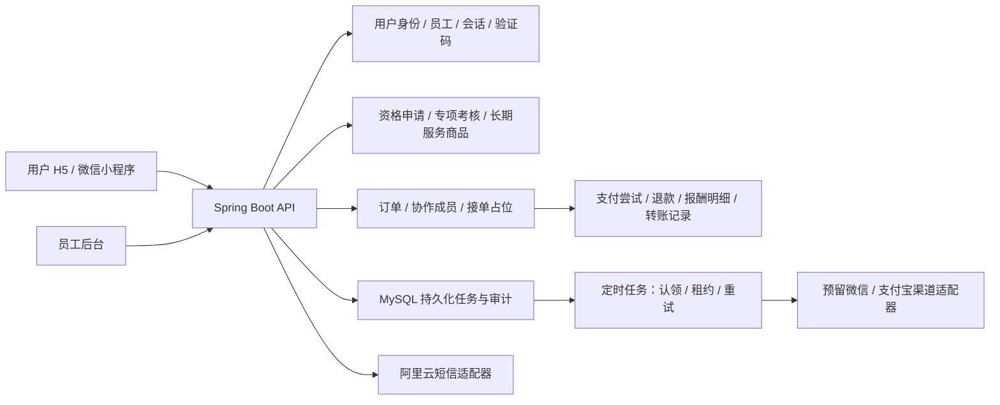

# Norman Club 服务端

管理后台使用账号密码登录，当前最高权限账号为 `norman_app_manager`。账号初始化仅在服务器本地读取私有 BCrypt 哈希文件，源码不包含默认密码。用户端仍可使用免登录体验身份，短信及支付继续保留接口。后台已经移除员工演示身份和切换入口。

服务端已按此前的低成本方案实现：**Java 21、Spring Boot 4.1.2、Spring Security、MyBatis 4.1.0、MySQL 8.4、Flyway**。一个应用处理用户端和员工后台，会话、验证码、限流与后台任务使用同一个 MySQL；不需要 Redis 或消息队列。

代码在 `server/`，所有 `v1` 接口均来自真实数据库。前端 `mock` 模式保留独立的浏览器演示；`http` 模式使用真实认证和数据库，禁止演示身份切换、模拟支付、模拟走满时长及重置数据库接口。浏览器 Demo 记录不会自动导入真实库。

## 已保留的真实接口联调环境

当前电脑有单独的 MySQL 8.4 实例，**只监听 `127.0.0.1:3307`**；项目数据库为 `norman_club`，集成测试使用 `norman_test`。数据目录为被 Git 忽略的 `artifacts/mysql-data/`，开发配置保存在权限 600 的 `.local/server.env`。本机联调库与服务器内部验收库独立；云端流程、私人访问和数据库查看见[内部验收说明](ACCEPTANCE.md)。

```bash
npm run server:dev          # API：127.0.0.1:8080
npm run server:start        # 或直接运行已构建的 JAR
npm run build:http          # 独立生成 dist-http/，保留原来的 dist/ Demo
npm run preview:http        # 用户端和后台：http://127.0.0.1:4180/
```

- 用户端：`http://127.0.0.1:4180/mobile/`
- 员工后台：`http://127.0.0.1:4180/admin/`
- 健康检查：`http://127.0.0.1:8080/actuator/health`
- 当前云端管理账号：`norman_app_manager`；管理员密码不在公开仓库中。登录只需要账号和密码，无身份验证器步骤。
- 本地短信收件箱在 `.local/sms-outbox.jsonl`，权限 600。`delivery=development-outbox` **不发送真实短信**；填写测试手机号、点击获取验证码后读取此文件，再填写六位码登录。
- 新手机号自动创建普通用户，无组队／护航资格。先从“我的”提交申请，再由后台客户管理审核和录入考核成绩。
- 新真实库不灌入 Demo 的虚构订单或付费记录；初始商品目录为空。发布商品需要先取得对应资格。

这些链接是本机联调地址，无法直接供外地访问。此交付没有改变阿里云公网开放、域名或备案状态。

如果本机 MySQL 进程已停止，可使用安装好的二进制启动同一个隔离实例（不要启动第二个同端口实例）：

```bash
/opt/homebrew/opt/mysql@8.4/bin/mysqld --no-defaults \
  --datadir="$PWD/artifacts/mysql-data" --bind-address=127.0.0.1 --port=3307 \
  --socket="$PWD/artifacts/mysql.sock" --mysqlx=0 \
  --pid-file="$PWD/artifacts/mysql.pid" --log-error="$PWD/artifacts/mysql.log" \
  --innodb-buffer-pool-size=128M
```

## 在其他电脑初始化

安装 JDK 21、MySQL 8.4；`server/mvnw` 会下载已固定版本的 Maven。创建 UTF-8 数据库和独立应用账号，不给应用全局管理权限。将 `server/.env.example` 的配置写入根目录 `.local/server.env`，或者通过部署环境注入。正式环境无需 `.local` 文件。

分别执行两次 `openssl rand -base64 32`，配置不同的 `CLUB_ENCRYPTION_KEY` 与 `CLUB_HASH_KEY`；这些密钥需要稳定保存，不能每次启动重新生成。应用启动时通过 Flyway 自动创建和校验表结构，禁止生产 `clean`。SQL 位于 `server/src/main/resources/db/migration/`。

没有默认员工密码，也没有公开的管理员注册接口。首次初始化与密码恢复均是服务器本地维护操作：

```bash
npm run server:bootstrap -- norman_app_manager
npm run server:reset-staff -- norman_app_manager
```

命令会在交互终端询问新密码。自动化初始化可用权限 **600** 的 `CLUB_PASSWORD_FILE` 提供一次性密码文件；不要把密码放在命令行参数中。`reset-staff` 重置密码，并撤销旧会话，必须由有服务器管理权限的人执行。

也可通过 `CLUB_MANAGER_PASSWORD_HASH_FILE` 指定仅文件所有者可读的 BCrypt cost=12 哈希文件，用于首次创建 `norman_app_manager`（admin 权限）。初始化对已有账号不覆盖密码，应用重启也不会恢复旧密码。不要把密码或哈希放进公开仓库、构建后的前端或命令行参数。云端配置脚本见 `deploy/rds/enable-manager.sh`。密码规则为至少 8 位、包含字母和数字、最多 72 UTF-8 字节。

管理员也可调用 `POST /v1/admin/staff` 创建客服、财务或其他管理员，`PATCH /v1/admin/staff/{id}` 停用员工。员工停用立即撤销会话，且不能停用最后一位管理员。当前 PC 页面提供登录、认证、退出；员工创建和停用接口供运维/API 工具使用，尚未新增员工管理页面。

## 数据与业务边界



| 模块 | 实现 |
|---|---|
| 用户登录 | 内部用户 ID 与手机号身份分离；验证码单次使用、五分钟有效、五次错误失效；新用户没有任何接单资格 |
| 员工登录 | 独立员工表，BCrypt 12，账号密码登录；没有免密员工入口；员工权限每个请求从库读取 |
| 会话 | H5 使用 HttpOnly Cookie＋CSRF；小程序使用随机 Bearer，数据库只保存 token 哈希；退出、停用立即撤销 |
| 商品 | 两类资格按游戏分别授权；长期可重复预约；离线、忙碌仍可预约；价格、任务与成员采用服务端快照 |
| 订单 | 整数分；固定 20% 服务费；按单保存费率和价格；创建请求号幂等；待支付 10 分钟关闭 |
| 抢单 | 订单行锁与状态检查；`busy_slot` 主键限制同一成员只能有一笔未结束的参与订单 |
| 护航协作 | 负责人在开始前添加副手；副手需匹配资格、在线、空闲；开始后名单锁定；按人数均分到分 |
| 履约 | 组队使用服务端时钟校验时长；护航要求任务达成和完成记录；没有真实接口可跳过服务时长 |
| 售后 | 审核中和渠道处理中冻结履约及结算；渠道确认退款后重算净报酬；已记账订单暂不接受新退款，避免不完整的冲账 |
| 自动结算 | 用户确认后事务内生成唯一报酬份额与待转账记录；`credited` 表示记账，`paid` 才表示渠道转账完成 |
| 后台任务 | 和业务同事务入库；每五秒认领，60 秒租约；失败指数退避，最多八次，失败／渠道未配置保留问题状态 |
| 审计 | 登录、资格审核、派单、服务、退款、记账、账号禁用和 IP 封禁均留痕；不记录口令或验证码 |

任务不依赖浏览器保持打开。普通未支付订单在到期后下一次任务扫描（通常五秒内）关闭；若渠道结果未知，先查单／关单，不能把未知结果当作未付款。已关闭订单收到延迟收款会记录异常补偿任务，不重新进入接单大厅。

当前列表为有上限的轻量接口：订单／商品／申请最多 500 条，用户／服务档案最多 1000 条，明细超过该规模前需要改为分页。报酬总额、已到账总额及经营金额使用数据库聚合，不受明细列表上限截断；经营趋势按订单创建日归集，不能替代渠道账单对账。

## 短信配置

本地 `CLUB_DEVELOPMENT=true` 且 `SMS_PROVIDER=outbox` 才允许写收件箱；正式环境检测到此组合会拒绝启动。生产缺少配置或发送失败，返回 503，不创建可登录的验证码。

真实发送配置：

1. 在阿里云中国站申请并审核短信资质、签名、验证码模板。
2. 设置 `SMS_PROVIDER=aliyun`、`ALIYUN_SMS_SIGN`、`ALIYUN_SMS_TEMPLATE`；模板变量约定为 `code`。
3. 优先使用实例 RAM 角色和最小权限；也支持官方 SDK 的服务端凭据环境变量，禁止在前端配置 AccessKey。
4. 将每日短信总量上限设为可接受的实际预算，并核验发送结果。

使用官方 Java SDK，连接超时三秒、读取超时五秒；不在业务日志输出完整手机号和验证码。签名和模板的申请流程参见[阿里云短信 API 接入](https://help.aliyun.com/zh/sms/getting-started/use-sms-api/)。

## 支付预留接口

默认微信、支付宝适配器都 **disabled**，不是模拟成功。添加商户材料后仍需实现并验收官方 SDK 适配器，不能仅把 `enabled` 改为 true。

- `GET /v1/payments/channels`：渠道状态。
- `POST /v1/orders/{id}/payment-attempts`：创建幂等支付尝试；当前未接入渠道返回 503，订单仍为待支付。
- `GET /v1/payments/{id}`：本人或员工查询支付尝试及调起参数。
- `POST /v1/payments/notify/wechat`、`/alipay`：原始通知交给对应适配器验签；未配置时拒绝，不接受客户端声明已付款。
- `PaymentGateway` 预留创建、查单、关单、验签、退款方法。`VerifiedPayment` 只能由可信服务端适配器生成。
- 后端再核对渠道、商户、订单、币种、金额、渠道交易号，并用回调事件唯一键防重。
- 退款审批只进入 `processing`；渠道确认后才写 `refunded`，不在点击审批时假定退款完成。
- 自动结算当前自动 **记账**，`payout` 留在 `awaiting_channel`；实际转账 SDK、收款人绑定、验签回执、查单和对账属于后续接入内容。

正式接口没有 `/v1/auth/mock-login`、`/v1/demo/reset`、`/demo-elapse`，旧 `/orders/{id}/pay` 也不能修改收款状态。集成测试的支付替身仅在 `src/test/`，不进入发布 JAR。

## 构建与测试

```bash
npm run server:test       # H2 MySQL 模式：快速业务/HTTP/安全集成测试
npm run server:build      # 测试并构建 JAR
npm run check
npm test
npm run build:all         # Demo H5 / 后台 / 小程序
npm run build:http        # 真实 API 的 H5 / 后台
```

同一套服务端测试可使用实际 MySQL：通过 `TEST_DB_URL`、`TEST_DB_USERNAME`、`TEST_DB_PASSWORD` 指向独立测试数据库，再运行 `npm run server:test`。**禁止将测试指向生产库**；测试会创建账号、订单与资金替身记录，不会清理或回滚整套测试数据。当前已在 H2 与本机实际 MySQL 8.4 验证核心流程。

## 部署

`deploy/compose.yml` 提供 MySQL、Java API、Nginx HTTPS，数据库和 API 不发布公网端口。先配置 `deploy/.env`（参照示例）、TLS 证书和生产来源域名，生成 `dist-http/`，再执行：

```bash
docker compose --env-file deploy/.env -f deploy/compose.yml up -d --build
```

容器部署后的首次管理员初始化使用现有应用镜像，不需要在服务器安装 Maven 或 JDK：

```bash
docker compose --env-file deploy/.env -f deploy/compose.yml run --rm -it --no-deps api \
  --spring.main.web-application-type=none --club.command=bootstrap-admin --club.username=owner
```

在交互终端本人输入新密码。忘记密码时可将命令改为 `--club.command=reset-staff`，会撤销原会话并要求重新登录。

配置证书放在 `deploy/certs/fullchain.pem`、`privkey.pem`；证书不在仓库中。Nginx 将 `/api/` 转发给 API，并覆盖真实 IP 头。只信任 Nginx 的固定容器地址；如果调整子网，必须同步调整 `TRUSTED_PROXIES`。当前电脑没有 Docker，Compose 文件和镜像构建尚未在本机运行验证；JAR、实际 MySQL 和本机代理已独立验证。

内存上限为 API 768MiB、MySQL 512MiB、Nginx 96MiB；实际容量仍要在购买的 2GB 服务器上验证。每日备份需保存在服务器之外，并保存独立的加密密钥备份；脚本见 `deploy/backup.sh`。正式上线前配置短信、HTTPS、备案、监控与备份恢复，支付仍保持关闭，直到商户接入完成。
