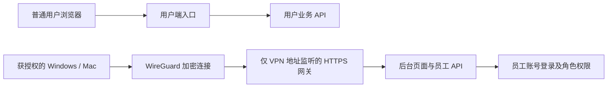

# 员工后台 VPN 运维手册

产品 **1.0.1，未正式发布**。2026-11-03新增部署实现；云端是否安装、设备实连和旧入口切换的结果以本文末尾的实施记录为准，不以代码存在代替上线完成。

## 访问方案



- WireGuard接口：`wg-norman`；服务器VPN地址：`10.77.42.1/24`；员工设备每台独立公钥及`/32`地址。
- VPN握手入口：服务器公网IP的`UDP 51820`。公网不开放后台HTTPS端口。
- 员工后台地址：`https://admin.veteranclub.icu:9443/admin/`。该域名A记录指向`10.77.42.1`，只有连接VPN的设备能路由到它；公开DNS中的私网地址不代表后台已对公网开放。
- 客户端仅设置`AllowedIPs = 10.77.42.1/32`；不设置全局DNS，不接管日常上网。服务端进一步只允许VPN设备访问本机`TCP 9443`，不授予SSH、RDS、其他内网或其他员工设备访问权限；不修改全局IP转发、默认路由或NAT。
- 后台继续使用现有账号密码、会话、CSRF、限流和管理员/客服/财务权限，VPN不代替应用登录。此版本不新增员工账号、共享VPN密钥或第三方VPN账户。
- 私有HTTPS网关使用独立Nginx进程及systemd服务，绑定VPN地址。VPN停止时仅后台网关停止，不停止原用户端网关和业务服务。

## 当前环境与生产边界

当前后端仍是私有`norman_acceptance`验收环境。新后台网关直接代理服务器本机`8091`，静态文件读取现有发布目录的`current/web/admin`。仅在严格核对员工域名/Origin后，把该单一来源转换为现有后端允许的本机来源；保留会话和CSRF校验，Cookie增加Secure。请求IP取VPN设备地址，清除外来转发链；日志不记录查询参数。

该部署不把用户端开放公网，不启用真实短信或支付，不移动/改写数据库。未来生产环境要使用普通生产构建、正式数据库/配置及各自HTTPS来源；不能把当前验收包的本机Origin转换当作生产配置。

公网Nginx模板`deploy/nginx.conf`已拒绝后台页面、`/api/v1/admin`及子路径、员工登录接口和员工会话请求。员工会话头匹配包含重复头合并后的`staff, user`，防止只拦页面或只拦某一个Header值。

云端切换还会同时关闭原`8088`验收入口和旧`8080`静态入口的后台路径。因此原SSH `4190/admin/`和`preview:8443/admin/`切换后不再是管理入口；用户端预览保持原状。服务器本机管理员直接访问后端是运维信任边界，不授予普通VPN员工。

## 首次安装顺序

实现脚本为`deploy/vpn/admin_vpn.py`，只在已核对的Ubuntu服务器由现有管理员执行。电脑固定命令部署账号仍只具备应用上传、部署和健康查询权限，不给它通用root/sudo或网络管理权限。

1. 使用Ubuntu官方软件源安装`wireguard-tools`；已有Nginx、iptables和certbot继续复用。检查VPN网段不与现有路由冲突。
2. 通过DNS-01为`admin.veteranclub.icu`取得受信任证书，保存于`/etc/letsencrypt/live/admin.veteranclub.icu/`。证书不要求开放公网网站端口；不要在浏览器跳过证书告警。维护DNS记录和续签流程。
3. 云防火墙仅新增`UDP 51820`，来源按员工实际网络管理；不放行`TCP 9443`、后端端口、数据库端口。服务器脚本添加的规则有独立标识，不清空已有iptables策略。
4. 将审核过的脚本放到服务器，执行：

   ```sh
   sudo python3 admin_vpn.py install --endpoint 8.133.228.181
   ```

   该操作创建独立服务器密钥、VPN接口和私有网关，暂不改变旧网站入口。服务器密钥只保存在服务器受保护文件内，任何返回结果都不包含私钥。

   若证书DNS验证还在等待，可先执行`install --prepare-only --endpoint 8.133.228.181`，只启动VPN、生成独立服务器密钥并写入尚未启动的HTTPS网关配置；证书取得并校验后执行`gateway-enable`，不会更换服务器密钥，也不会先开放无效TLS网关。

5. 每台设备生成自己的WireGuard密钥，仅将公钥交给管理员。设备标签区分电脑，例如`owner-mac`、`staff01-windows`。登记公钥：

   ```sh
   sudo /usr/local/lib/norman-vpn/admin_vpn.py peer-add --name owner-mac --public-key '<设备公钥>'
   ```

   登记分配唯一设备地址，立即同步运行配置并持久化，不重启其他人的连接。私钥不发聊天、不入Git，也不放共享云盘。

6. 员工安装官方客户端并导入/填写本机配置，连接后确认可信HTTPS证书、后台登录和角色权限。
7. 确认已授权设备确实握手且已打开后台后，再关闭旧管理入口：

   ```sh
   sudo /usr/local/lib/norman-vpn/admin_vpn.py cutover
   ```

   脚本要求15分钟内实际握手，核对HTTPS、备份旧配置、`nginx -t`后重载，并在10秒检查窗口内等待所有后台/员工API旧入口404、用户页和用户API正常。Nginx收到重载信号不代表新worker已接管，不能在刚重载时把旧页面200直接判作部署失败；检查到期仍不满足则恢复原入口，不改数据库或应用发布包。设备是否实际打开页面仍需本人验收，握手不能代替浏览器验收。

## Windows 和 Mac 配置

从[WireGuard官方安装页](https://www.wireguard.com/install/)获取对应客户端。Windows使用官方安装包；Mac使用官方链接指向的Mac App Store版本。客户端导入会创建网络隧道，需要由设备本人确认系统提示。

Mac App Store无法获取官方客户端时，可使用官方安装文档支持的Homebrew命令行版：`brew install wireguard-tools`。当前所有者Mac已安装该版本；`deploy/vpn/macos-vpn.sh`提供连接/断开操作，私有设备配置和启动文件只保存于本机`.local/vpn/`，没有放入Git。启动调用系统sudo，由设备本人在终端输入本机密码，脚本不采集、保存或上传该密码；仅路由`10.77.42.1/32`，不改变全局DNS。重启电脑后按需重新连接，不安装自动启动服务。

当前Mac本机操作文件为`.local/vpn/连接员工后台VPN.command`和`.local/vpn/断开员工后台VPN.command`，配置为`.local/vpn/norman-mac.conf`（0600，目录0700）。该配置只属于当前`owner-mac`设备，Windows或其他Mac必须生成并登记自己的公钥，不能复制此配置。

每台设备的配置结构如下；实际地址和服务器公钥以登记结果为准：

```ini
[Interface]
PrivateKey = <只保存在本机的设备私钥>
Address = <管理员分配的设备地址>/32
MTU = 1280

[Peer]
PublicKey = <服务器公钥>
Endpoint = 8.133.228.181:51820
AllowedIPs = 10.77.42.1/32
PersistentKeepalive = 25
```

连接VPN后，打开`https://admin.veteranclub.icu:9443/admin/`，再用员工账号登录。断开VPN后应无法打开。不要把服务端私钥填到客户端，也不要在多台设备复用配置；同一公钥同时上线会相互顶替。

如果员工网络拦截DNS返回的私网地址，可在该设备管理员管理的hosts中增加`10.77.42.1 admin.veteranclub.icu`，它只影响此后台域名。浏览器证书仍必须与域名匹配；不配置关闭证书校验。

## 日常管理与撤销

```sh
sudo /usr/local/lib/norman-vpn/admin_vpn.py status
sudo /usr/local/lib/norman-vpn/admin_vpn.py peer-revoke --name staff01-windows
```

状态只输出设备标签、VPN地址、最近握手时间、网关状态和服务器公钥，不输出任何私钥。撤销后立即从运行和持久化配置删除设备公钥；原设备配置不能再次接入。离职还应在应用层停用员工账号并撤销会话；网络撤销不能代替账号停用。

检查`systemctl status wg-quick@wg-norman norman-staff-gateway`、证书到期日、云防火墙和设备握手。VPN防火墙仅放行9443，普通ping不作为可用性判断。

日常固定命令应用部署只切换`current`发布目录，不重写VPN和已隔离的Nginx配置。人工重装服务器或替换Nginx站点时必须保留`BEGIN NORMAN VPN ONLY`规则并重新检查旧入口404，不能直接用早期验收模板覆盖现有站点。

回退管理入口（保留VPN）：

```sh
sudo /usr/local/lib/norman-vpn/admin_vpn.py restore
```

只有当前配置仍与本次切换后的校验值一致才自动恢复；若其他管理员已修改网关，拒绝覆盖，需人工核对。回退会恢复原SSH管理入口，须由有权限的运维人员执行。

证书续签后执行`nginx -t -c /etc/norman-vpn/nginx.conf`，再`systemctl reload norman-staff-gateway`。根证书、ACME挑战及续签方式应在实际签发时记录；没有配置自动续签时不得宣称证书会自动更新。

证书使用现有Let's Encrypt账户和DNS-01。`deploy/vpn/cert_dns_hook.py`只接受后台域名，挑战值暂存于服务器`/run/norman-admin-cert/challenge.json`（0600），以ASCII整数输出，避免O/0/l/I录入误差。管理员在DNS控制台更新`_acme-challenge.admin`，核对权威DNS结果后，在服务器将本次挑战的实际值写入同目录`ready`文件，hook再继续验证；不保存DNS AccessKey，不具备自动更新DNS权限。已有错误记录的缓存尚未过期时，应等到TTL过期再验证。本次仍为人工DNS续签流程，须在证书到期前完成新挑战及网关重载。

## 验证与实施记录

- 隔离测试覆盖公网后台/员工接口拒绝、编码路径、重复会话头、可信TLS、精确Origin、Secure Cookie、逐设备授权/撤销、切换前握手门槛及失败回退。不连接业务库，不改本机VPN或防火墙。
- 2026-11-03上述10项测试全部通过，包含分阶段网关启动前证书复核、异步重载后完整策略等待，以及持续错误策略恢复原配置的用例；其中2项使用实际Nginx和隔离HTTP/TLS服务验证，没有跳过证书检查。本机安装Nginx测试工具和官方Homebrew WireGuard客户端，未注册自动启动服务。
- 2026-11-03实施前只读核对：现有Ubuntu 24.04服务器及管理员会话可用；原用户端/后台入口为服务器本机8088和8443。当时尚未安装WireGuard，后续实际变更如下。
- 2026-11-03所有者已确认安装、UDP51820、内网域名及当前Mac设备授权。云端已安装WireGuard、启动`wg-norman`、新增唯一UDP握手规则；A记录`admin → 10.77.42.1`已生效。当前Mac公钥已登记为`owner-mac / 10.77.42.2`，公钥指纹为`SHA256:vU9aV/CsJwmdJJXu3r/jUQ3pvtJqSXVrkFHLw10n1rw`；私钥仅留本机。
- 2026-11-03后台证书签发成功：Let's Encrypt YE1，证书到期时间为`2027-02-01 03:38:09 UTC`（北京时间11:38:09）。独立`norman-staff-gateway`已启用。服务器通过受信任TLS访问后台页面200、匿名管理API401、错误Origin403、错误Host404；原用户端及旧后台各200。从当前Mac直接连接公网IP的TCP9443不可达，云防火墙没有开放该端口。证书仍需人工DNS续签，不以certbot的通用自动续签提示作为DNS已自动化的依据。
- 2026-11-03所有者本人运行Mac连接脚本后确认已连接。服务器检测到`owner-mac`实际握手；Mac通过受信任TLS访问后台200，浏览器刷新后正常展示登录页。工具未读取或代填本机密码。
- 2026-11-03完成`cutover`：旧8080/8088后台及旧管理API404，8088员工登录、staff会话和重复staff/user头404，旧preview:8443后台404；VPN后台200、匿名管理API401；云端8088/preview:8443用户端和用户业务API200。公网IP的TCP9443不可达。首次切换因Nginx重载异步生效而读到旧页面200，已自动恢复；修复并通过10项测试、校验上传SHA256后重新切换成功。
- 当前Mac的本地4190 SSH隧道未运行，对该端口的探测为连接拒绝，不能把它记作HTTP404或用户端服务故障。上述旧入口封闭与用户端健康通过服务器对应端口验证，用户端原有SSH访问配置没有改动。
- 云端最终记录：`/etc/norman-vpn/verification-20261103.json`；仓库证据：`artifacts/admin-vpn-cutover-20261103.jpg`及`artifacts/admin-vpn-plan-20261103.json`。Windows步骤已备妥，尚未登记或测试具体Windows设备，后续每台设备使用独立公钥。

参考：[WireGuard快速配置](https://www.wireguard.com/quickstart/)、[官方客户端](https://www.wireguard.com/install/)。
