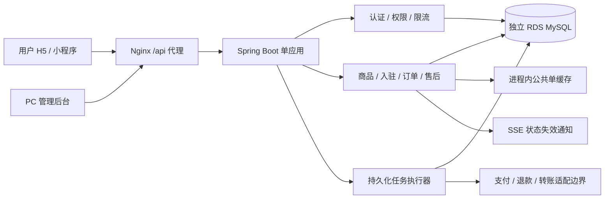
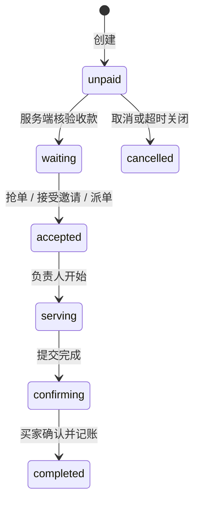

# 诺曼部落 · 后端维护手册

| 项目 | 当前基线 |
|---|---|
| 产品版本 | **1.0.1**，前后端共用起始版本 |
| 发布状态 | **未正式发布**；云端部署是内部验收 |
| 核对日期 / 源码 | 2026-10-26，Asia/Shanghai / `33695dc` |
| 数据库结构 | Flyway **V5**；迁移编号和产品版本独立 |
| 配套手册 | [前端：页面与入口](FRONTEND.md) · [数据库：表与字段](DATABASE.md) |

## 版本与文档维护约定

正式发布前所有修改继续记在 **1.0.1**，不能因提交代码、修改接口、增加迁移或部署验收而升版本。每次修改更新对应章节，并追加文末开发记录。项目所有者明确正式发布后，冻结三份手册到 `docs/releases/1.0.1/`，记录发布提交、日期、构建模式、迁移版本和未接入能力；下一产品版本由所有者指定。完整规则见[前端手册](FRONTEND.md#阅读与版本维护规则)。

当前 Maven 构建坐标仍为 `norman-server:1.0.0`，它是工程产物号；不代表已经正式发布，也不替代这里的 1.0.1 功能基线。本次文档整理不调整 JAR 名称或部署脚本。

## 实现、运行环境与能力边界

服务端位于 `server/`：Java 21、Spring Boot 4.1.2、Spring Security、MyBatis 4.1.0、MySQL 8.4、Flyway。一个应用同时服务用户和员工，两套会话分离。



| 事项 | 当前状态 |
|---|---|
| 部署 | 原阿里云轻量服务器已原地升为 2 核 4GB；API 和 Nginx 本机监听，通过 SSH 隧道验收 |
| 数据库 | 独立 RDS `norman_acceptance`；应用使用普通账号 `norman_service`，TLS 校验证书与主机名 |
| 数据库管理 | DMS 是查表和执行 SQL 的管理工具；RDS 才是数据库服务。旧同机 MySQL、Adminer 已移除 |
| Redis / 消息队列 | 当前没有接入或购买依赖；限流、会话和任务保存在 MySQL，公共单与 SSE 为单应用内存状态 |
| 用户登录 | 短信代码和阿里云发送适配器已实现；材料未配置。当前验收使用固定体验用户 |
| 管理登录 | 真实账号密码，当前使用 `norman_app_manager`；不需要验证器；旧三个员工演示账号已清理且不会自动重建 |
| 收款、退款 | 普通包的微信/支付宝适配器未接入，返回 503；验收包有独立模拟渠道，不能产生真实资金流 |
| 自动结算 | 订单确认后自动记账、生成转账待办；尚未完成真实向成员打款 |
| 正式发布 | 尚无正式发布版本；当前私有验收地址不是公网生产站点 |

应用 API 本机端口当前为 8091，Nginx 为 8088，本地隧道为 4190。普通本地开发默认 API 8080。环境部署细节见 [SERVER.md](../SERVER.md)、[RDS.md](../RDS.md)、[ACCEPTANCE.md](../ACCEPTANCE.md)。本文不保存密码、哈希、私钥、验证码或数据库连接凭据。

## 协议与权限基础

### 地址、响应与请求头

下面接口以 Java 路由 `/v1/...` 记载。通过网站访问通常加 `/api`，例如 `http://127.0.0.1:4190/api/v1/orders`；Nginx 转发后移除 `/api`。

一般接口返回：

```json
{"code":0,"message":"ok","data":{},"requestId":"请求追踪标识"}
```

异常使用相应 HTTP 状态和 `code`：400 参数错误，401 未登录/会话失效，403 越权，404 不存在，409 状态或唯一性冲突，413 请求过大，415 媒体类型错误，429 频率限制，503 渠道未接入/暂不可用。SSE、Actuator 健康和支付回调成功响应不使用上述通用包装。

| 项目 | 约定 |
|---|---|
| 金额 | 整数分；不要把前端显示的元直接写进金额字段 |
| 时间 | Unix 毫秒；报表按 Asia/Shanghai 日历日；Flyway `installed_on` 例外是 SQL TIMESTAMP |
| 请求体 | JSON；未知字段拒绝；普通请求体最大 64 KiB |
| 用户/员工区分 | `X-Session-Audience: user / staff`，省略按 user |
| H5 | `credentials: include`，用户/员工各自的 HttpOnly Cookie；修改请求带 `X-CSRF-Token` |
| 小程序用户 | `X-Client-Type: mini-program`，短信登录签发 Bearer；员工不支持 Bearer 登录 |
| Origin | 必须在明确白名单内；配置的受信代理才可提供 `X-Real-IP` |
| 幂等 | 创建订单、创建支付使用 `Idempotency-Key`，8～80 位字母、数字、下划线或连字符 |
| PATCH 兼容 | 仅 `products/{id}`、`admin/players/{id}` 允许 POST 加 `X-HTTP-Method-Override: PATCH`；仍检查会话和原权限 |

### 身份与数据可见性

| 身份 | 范围 |
|---|---|
| 匿名 | 游戏、俱乐部规则、支付渠道、健康检查，以及登录/短信发送；支付通知走独立验签 |
| 普通用户 `user` | 购买、查看本人下单/参与/指定给本人待接的订单，提交入驻和售后 |
| 已入驻用户 | 仍是 `user`；额外按“游戏×组队/护航”授权发布、接单、协作，不是仅靠一个 player 角色 |
| 管理员 `admin` | 运营查询、审核、派单、退款、员工、封禁、安全与任务查询 |
| 客服 `customer_service` | 运营查询、派单/改派、取消未支付单、代客提交售后；不能审核入驻或批准退款 |
| 财务 `finance` | 运营查询、退款审核、记账查询；不能派单或审核入驻 |

后两种员工角色的后端能力仍保留，但当前没有演示账号或切换入口。`scope=all` 不是用户越权读全库的开关，最终仍按登录身份限制数据归属。

## 接口目录：登录与公共信息

| 方法与路径 | 身份 / 参数 | 作用与主要返回 |
|---|---|---|
| `POST /v1/auth/sms/send` | 匿名；`phone` | 发送六位短信验证码；返回 `expiresIn/retryAfter/delivery`；材料未配置不假装发送成功 |
| `POST /v1/auth/sms/login` | 匿名；`phone,code` | 验证后登录；首次手机号建立用户、加密身份和未入驻服务档案 |
| `POST /v1/auth/staff/login` | 匿名；`username,password` | 员工密码登录；返回会话，设置 staff Cookie；没有 TOTP 第二步 |
| `GET /v1/auth/session` | 已登录 | 恢复当前身份、名称、角色、服务档案 ID |
| `POST /v1/auth/logout` | 已登录 | 撤销当前会话，清空对应 Cookie |
| `GET /v1/club` | 匿名可读 | 名称、服务费 `commissionBps=2000`、待支付超时 10 分钟、公告；无设置写接口 |
| `GET /v1/catalog/games` | 匿名可读 | 游戏、短标识、色值、介绍和区服；目录来自代码常量，不在独立游戏表 |
| `GET /actuator/health` | 匿名可读 | 服务/数据库健康；通过网站访问 `/api/actuator/health`，不公开敏感详情 |

用户会话 7 天；员工最长 8 小时，连续 30 分钟无活动失效。数据库只保存 token/CSRF 的哈希。账号停用和退出后不能继续使用旧会话。密码恢复是服务器本机维护命令，没有公开重置口令接口。

## 接口目录：成员、商品、入驻

| 方法与路径 | 身份 / 参数 | 用途及关联数据 |
|---|---|---|
| `GET /v1/players` | 已登录；可选 `gameId` | 员工看档案列表；用户看已认证成员和本人；返回 `qualificationGames`、`available`、从占单计算的 `busy` 等 |
| `GET /v1/players/events` | 仅用户；SSE | 推送 `presence`/`heartbeat` 失效通知，让前端重读成员状态；不是聊天、订单完整推送或在线心跳系统 |
| `GET /v1/products` | 已登录；`scope=public/mine` | public 在售官方/合格个人目录；mine 仅本人商品，包括下架商品 |
| `POST /v1/products` | 用户；`gameId,serviceType,title,description,price,task?` | 已通过对应项目入驻才可发布；标题 2～40 字、说明 5～200 字、价格 100～100000 分；护航任务 1～200 字 |
| `PATCH /v1/products/{id}` | 商品本人；`active` 布尔 | 上下架；重新上架要检查入驻资格；不支持直接改价格、说明等字段 |
| `GET /v1/applications` | 已登录 | 用户看本人、员工看全部申请；返回审核进度和反馈 |
| `POST /v1/applications` | 用户；`serviceType,gameIds,introduction` | 单次 `gameIds` 只能一个游戏；介绍 10～500 字；同一项目有待审申请或已通过时拒绝重复 |
| `POST /v1/admin/applications/{id}/review` | 管理员；`status,score?,note` | `assessment/approved/rejected`；说明 2～500 字；通过需先进入考核且成绩 60～100；只授予该游戏该类型 |
| `POST /v1/player/availability` | 已入驻本人；`available` | 设置接单意愿；true 时不能有占单；false 在 UI 表示服务中/暂停新接单，不自动下架商品 |
| `PATCH /v1/admin/players/{id}` | 管理员；`price?,available?,approved?` | 调整档案建议价/意愿；`approved` 只能传 false，撤销全部入驻项目；不能通过 true 绕过考核 |
| `GET /v1/player/wallet` | 用户 | 本人报酬总额、待转账/已到账金额、完成订单和收入记录；API 存在，前端无独立钱包底部 tab |

游戏：`delta` 三角洲（国服）；`valorant` 无畏契约（国服·华东/华南/华北）；`lol` 英雄联盟（艾欧尼亚/峡谷之巅/黑色玫瑰）。组队 `hourly`，护航 `escort`。

当前共有六个可独立入驻项目。`service_profile.game_ids` 是档案擅长游戏，不能据此授予接单权；实际授权来自 `service_qualification(player_id,service_type,game_id)`。`approved=false` 会停用已有授权。

## 接口目录：订单

| 方法与路径 | 身份 / 参数 | 作用 |
|---|---|---|
| `GET /v1/orders` | 已登录；`scope,status,serviceType,gameId,query,refund` | 列表；scope 为 mine/all/hall；用户始终按归属授权，hall 再按入驻项目筛选；最多 500 条 |
| `GET /v1/orders/{id}` | 下单人、参与者、指定待接成员、员工 | 单笔订单、商品/金额快照、团队、时间线和记账状态 |
| `POST /v1/orders` | 用户；幂等键 + 下表字段 | 创建一个待支付订单和超时任务；价格、任务、服务成员由服务端商品确定 |
| `POST /v1/orders/grab` | 已入驻用户；`serviceType,gameId?` | 从公共池找到最早可接订单并接单；行锁、意愿、入驻和容量检查 |

### 创建订单字段

| 字段 | 含义与校验 |
|---|---|
| `productId` | 当前客户端必带选中商品；旧请求缺省时服务端解析为官方商品或指定成员对应商品 |
| `serviceType` | `hourly/escort`，必须与商品一致；旧请求缺省 hourly |
| `gameId,region` | 必填，必须在游戏/区服目录中且匹配商品 |
| `quantity` | 组队每份 1～8 小时；护航固定 1 次任务；整数 |
| `copies` | 1～99 的整数，省略默认为 1，显式 null/小数/字符串不接受 |
| `playerId` | 兼容旧参数；必须和个人商品发布者一致；官方商品不指定成员 |
| `task,taskPrice` | 兼容旧字段名，不能用来替换商品任务或定价；当前前端不提供买家定价 |
| `note` | 选填，最多 200 字 |

返回包含 `copies,quantity,unitPrice,amount,commissionBps,earnings`。金额=`unitPrice × quantity × copies`；预计收入为总金额按 20% 服务费计算后向下取整到分。对已有已退款订单则使用扣除已确认退款后的净额。相同用户、相同幂等键和相同内容返回同一订单；相同键不同内容返回 409。

例如购买官方三角洲组队服务，每份1小时、共3份的请求体（幂等键放请求头，不放JSON）：

```json
{
  "productId":"club-hourly-delta",
  "serviceType":"hourly",
  "gameId":"delta",
  "region":"国服",
  "quantity":1,
  "copies":3,
  "note":"服务开始时间待确认"
}
```

按当前预置单价，响应data中的 `amount=20400`、`earnings=16320`、`quantity=1`、`copies=3`、`status=unpaid`。这是结构/计算示例，不是已经创建的新订单；若商品价格被维护过，应以服务端返回快照为准。

### 订单动作

控制器为 `POST /v1/orders/{id}/{action}`，只接受下面已实现动作。未知 action 返回 404；不存在通用管理员任意修改订单状态接口。

| 完整路径后缀 | 身份 / 请求体 | 前置条件与效果 |
|---|---|---|
| `/accept` | 用户；空体 | 已付款 waiting、非冻结、不能自接；有相应入驻、available=true、无 busy_slot；个人单仅指定本人可接受；变 accepted |
| `/assign` | 管理员/客服；`playerId,reason?` | waiting/accepted；目标入驻、可接、非买家且无其他占单；改派时原因至少 2 字；重建参与人和占单 |
| `/add-assistant` | 负责人；`playerId` | 护航 accepted、非冻结、开始前；副手按游戏与护航入驻、空闲且非买家；最多 8 人含负责人 |
| `/remove-assistant` | 负责人；`playerId` | 同上，只能移除已加入的副手，不能移除负责人 |
| `/start` | 负责人；空体 | accepted、非冻结；写 startedAt，变 serving，之后名单不能变动 |
| `/finish` | 负责人；`note,taskCompleted?` | serving、非冻结；note 2～200；组队服务端计时须达到 quantity×copies 小时；护航需 taskCompleted=true；变 confirming |
| `/confirm` | 下单人；空体 | confirming、非冻结；变 completed，释放占单，同事务生成每位成员收入与转账待办；已完成重复确认不重复记账 |
| `/cancel` | 下单人/管理员/客服；空体 | 仅 unpaid，且没有 creating/pending/unknown 支付尝试；变 cancelled |
| `/refund` | 下单人/管理员/客服；`amount,reason?` | 已付款、未取消、无已记账份额，售后 none/rejected；金额 1～订单金额分；原因选填，空时“用户申请售后”；进入 pending |
| `/review-refund` | 管理员/财务；`approve,note` | 仅 pending；说明 2～500；同意进入 processing 并排退款任务；拒绝变 rejected |
| `/pay` | 不支持真实收款 | 普通包直接返回 503；不能靠客户端调用把订单改成已支付 |

官方商品付款后，订单没有 preferred_player，进入公共池；个人商品付款后保持指定发布者，在该成员的私有单展示。卡片写“随机分配”，但后端目前没有自动随机派单算法。抢单和派单才真正分配负责人。

### 状态及一致性



售后单独为 `none → pending → processing → refunded`，或 `pending → rejected`。pending/processing 冻结接单、开始、提交、确认和记账。渠道确认全额退款变 cancelled 并释放容量；部分退款保留履约状态，按原费率重算预计收入。已有收入记账后禁止新退款，尚无结算冲账流程。

订单用数据库行锁和 `version` 条件更新；成员容量用 `busy_slot.player_id` 主键约束。负责人和副手都占容量。完成后释放 busy_slot，若原 `available=true` 则显示恢复接单中；手动设为 false 的成员不会凭空被打开接单意愿。

## 接口目录：支付与退款预留

| 方法与路径 | 身份 / 参数 | 当前作用 |
|---|---|---|
| `GET /v1/payments/channels` | 匿名可读 | 返回 channel/enabled/message；wechat、alipay 当前均 false |
| `POST /v1/orders/{id}/payment-attempts` | 下单人；`channel` + 幂等键 | 渠道接入后创建 creating 支付尝试；复核商品和入驻、禁止重复未决支付；未配置时 503 |
| `GET /v1/payments/{id}` | 支付人/员工 | 查询状态、金额和客户端调起参数 `clientParams` |
| `POST /v1/payments/notify/wechat` | 渠道；原始 body + 请求头 | 交给适配器验签；再校验商户、金额、币种、交易号、通知事件唯一性 |
| `POST /v1/payments/notify/alipay` | 同上 | 成功响应 `success`；微信成功响应 SUCCESS JSON；不是前端支付确认接口 |

`PaymentGateway` 定义 create/query/close/verify/refund 边界，`PaymentPorts.Unconfigured` 是当前正式包的实现。接口框架、落库、防重和补偿任务已经存在，但没有真实微信/支付宝 SDK 实现。只配置一个开关不能让它变成可收款系统。

收款成功→waiting；已取消订单迟到收款记 `late_paid`，重复收款记 `duplicate_paid`，进入 `PAYMENT_EXCEPTION` 待人工/后续渠道补偿，不重新放入公共池。退款批准不等于渠道已退，须退款任务确认后才写 refunded。

## 接口目录：管理与安全

| 方法与路径 | 身份 / 参数 | 用途；当前 UI |
|---|---|---|
| `GET /v1/admin/users` | 任一员工 | 注册用户目录、档案和脱敏手机号；客户管理使用 |
| `PATCH /v1/admin/users/{id}` | 管理员；`disabled` | 停用/启用用户并撤销用户会话；当前无对应按钮 |
| `GET /v1/admin/dashboard` | 任一员工 | 实收、订单、成员、7 日趋势、游戏分布、动态；概览页 |
| `GET /v1/admin/settlements` | 管理员/财务 | 收入记账记录，只读；没有独立结算菜单 |
| `GET /v1/admin/audit` | 管理员 | 最近审计记录；操作日志页 |
| `GET /v1/admin/staff` | 管理员 | 员工目录，不返回密码哈希或 TOTP 密文；无员工管理页 |
| `POST /v1/admin/staff` | 管理员；`username,name,role,password` | 创建真实员工，角色 admin/customer_service/finance；无管理页 |
| `PATCH /v1/admin/staff/{id}` | 管理员；`disabled` | 停用/启用并撤销会话；不能停用自己或最后一个有效管理员；无管理页 |
| `GET /v1/admin/security/ip-bans` | 管理员 | 封禁列表；无独立 UI |
| `POST /v1/admin/security/ip-bans` | 管理员；`ip,reason,minutes` | IP 字面值、原因 2～200、时长 1～10080 分钟；不能封当前管理连接 IP |
| `DELETE /v1/admin/security/ip-bans?ip=...` | 管理员 | 解除指定 IP 封禁；无独立 UI |
| `GET /v1/admin/tasks/problems` | 管理员 | 最多 100 个 blocked/failed 任务；没有自动恢复任务的 HTTP 接口或页面 |

管理员初始化/密码恢复命令为 `npm run server:bootstrap -- <账号>`、`npm run server:reset-staff -- <账号>`，在服务器本机维护。私有 BCrypt 文件可首次初始化 `norman_app_manager`，重启不覆盖已有密码。数据库账号 `norman_app/norman_service` 与网页登录账号是不同体系。

## 内部验收与 Mock 专用能力

| 接口/能力 | 仅何处存在 | 作用 |
|---|---|---|
| `POST /v1/auth/sms/login/acceptance` | `-Pacceptance` JAR | `{role:user/player,accountId?}` 切换限定验收用户；拒绝员工角色 |
| `POST /v1/acceptance/orders/{id}/pay` | 验收 JAR，订单买家 | 通过 acceptance 渠道模拟付款，不是真钱 |
| `POST /v1/acceptance/orders/{id}/demo-elapse` | 验收 JAR，服务中组队负责人 | 将开始时间移至约定 quantity×copies 小时之前，模拟走满时长 |
| `/v1/auth/mock-login`、`/v1/demo/reset`、普通 `/orders/{id}/demo-elapse` | 浏览器 Mock | 内存/本地存储调用；普通服务 JAR 没有对应真实能力 |

验收 Transport 将用户 mock-login 和 pay/demo-elapse 重写到验收路径。验收包同时要求本机监听、开发模式、显式 ACCEPTANCE_MODE、独立 norman_acceptance、核准的 TLS RDS 主机、本机来源和代理、真实短信关闭；不用于公网生产。

验收种子仅在用户不存在时创建 5 个测试用户档案，包含普通老板、仅组队、仅护航、两类均入驻和副手。旧演示员工不自动重建；当前服务端只保留真实管理员登录。演示数据与产品能力分开记录，不把测试订单数当作版本内容。

## 缓存、任务、收入与安全实现

### 缓存和 SSE

`PublicOrderPool` 保存单实例公共单索引，事务提交后失效，最长约 5 秒重建；订单全部持久化在 RDS，重启不丢单。SSE 只发刷新信号，事务提交后每 300ms 合并，10 秒心跳，连接 55 秒到期重连；全局最多 512 连接、单用户 4 连接。多实例部署前需要共享失效机制，当前没有 Redis 分布式锁/缓存。

### 自动任务

| 类型 | aggregate_id 指向 | 做什么 |
|---|---|---|
| `CLOSE_ORDER` | 订单 ID | 创建后 10 分钟关闭未支付单；存在未决支付则等待查单，不盲目取消 |
| `PAYMENT_CREATE` | 支付尝试 ID | 向已配置渠道准备支付参数 |
| `PAYMENT_QUERY` | 支付尝试 ID | 查单及到期关单，发现已支付走服务端确认 |
| `REFUND` | 退款申请 ID | 发起/查询退款，核验结果后更新订单 |
| `PAYOUT` | 转账记录 ID | 当前 blocked；实际向成员转账待实现 |
| `PAYMENT_EXCEPTION` | 支付尝试 ID | 当前 blocked；迟到/重复收款的补偿待处理 |

每 5 秒扫描，每轮最多认领 20 个任务；`FOR UPDATE SKIP LOCKED`、60 秒租约、退避重试，尝试达到 8 次失败后标 failed；未配置渠道标 blocked。每分钟补充遗漏的超时订单任务；每小时清理过期会话和旧验证码/挑战/限流记录。没有自动清理业务订单的定时任务。

### 收入模型

买家确认完成时同事务写 `income_entry(status=credited)`、`payout(status=awaiting_channel)` 和 PAYOUT 任务，并关联每位成员的 settlementId。整单预计收入按负责人和副手均分，分的尾差按成员 position 顺序补齐。`credited` 仅表示记账；`paid` 才表示真实转账完成，当前正式渠道未接入，不能把钱包 pending 当现金余额可提现。

### 安全措施

| 范围 | 当前实现 |
|---|---|
| SQL/输入 | MyBatis `#{}` 参数绑定、固定 SQL、转义 LIKE、字段白名单、整数和范围校验；无用户 SQL 执行接口 |
| 凭据 | BCrypt cost=12；手机号 AES-256-GCM 加密、HMAC 索引；token 仅存哈希；日志不输出密码/验证码 |
| 用户验证码 | 六位、5 分钟有效、单次使用、5 次错误失效；60 秒发送间隔、每手机号 5次/小时和10次/日、单 IP30次/小时；全站默认200条/日 |
| 登录与封禁 | 员工 IP20次/分钟、账号10次/5分钟；IP15分钟内超过20次验证失败封30分钟 |
| 通用请求 | IP1200次/分钟、账号300次/分钟；限流 MySQL 独立事务，失败业务不回滚安全计数 |
| 代理/来源 | 明确 Origin；只接受配置代理的 X-Real-IP，忽略 X-Forwarded-For；正式配置要求 HTTPS 与 Secure Cookie |
| 并发/幂等 | 事务、行锁、version、成员占单主键、订单/支付请求与记账唯一约束、通知去重 |

这是已有应用防护的清单，不代表完成正式上线安全验收。TOTP 辅助类和历史字段保留，但当前没有绑定/验证路由，不应把它列为已启用登录要求。

## 数据范围、已知限制与维护位置

| 范围 | 当前上限 / 限制 |
|---|---|
| 常规订单、商品、入驻申请列表 | 最多 500 条；不是游标分页接口 |
| 用户、服务档案、收入明细 | 最多 1000 条；钱包总额使用库内聚合，不受明细上限影响 |
| 审计 / 问题任务 | 审计最多 300 条；问题任务最多 100 条 |
| 经营趋势 | 按订单创建日归集当日订单净收款，不等于渠道到账对账单；今日实收按支付时间统计并扣已确认退款 |
| 配置 | 固定20%和10分钟；没有俱乐部设置写 API；游戏目录为代码常量 |
| 商品维护 | 个人商品发布/上下架已实现；官方目录通过数据库维护；没有官方商品编辑后台 |
| 订单/账号删除 | 没有业务 HTTP 删除入口；既往指定数据清理由人工核对后事务执行，不是公开产品能力 |
| 待接入 | 微信身份、真实支付/退款/转账、对账、收款人绑定、退款冲账、实时客服/图片上传、生产环境监控与正式验收 |

| 修改目标 | 代码入口 |
|---|---|
| 路由 | `auth/AuthController`、`business/ClubController`、`admin/AdminController`、`payment/PaymentController` |
| 商品与入驻 | `business/CatalogService`、`CatalogMapper` |
| 订单规则与读模型 | `business/OrderService`、`OrderMapper`、`OrderViews` |
| 收款退款与收入 | `payment/PaymentService`、`PaymentGateway`、`PaymentPorts`、`business/LedgerService`、`LedgerMapper` |
| 会话与权限 | `auth/AuthService`、`security/ApiSecurityFilter`、`config/SecurityConfig` |
| 限流/封禁/任务 | `security/AbuseService`、`SecurityMapper`、`jobs/TaskRunner`、`TaskService` |
| DB 结构 | `server/src/main/resources/db/migration` 和 `server/src/main/java/db/migration` |

发布前按变更运行 `npm run server:test`，验收包运行 `npm run server:build:acceptance`；普通包运行 `npm run server:build`。不要将自动化测试指向实际业务库。

当前 RDS 应用账号无 ALTER 权限：新增迁移先由数据库管理入口准备 DDL，再发布应用登记/校验迁移；V5 已支持预建字段/约束。V5 增加 copies 默认1，不改历史金额。应用更新脚本 `deploy/rds/update.sh` 创建新发布目录、切换 current、重启并检查健康，失败恢复旧应用；不是双实例零停机发布，也不会自动回滚数据库结构。不可兼容迁移需单独设计升级和回退步骤。

## 1.0.1 开发记录（未正式发布）

| 日期 | 内容 | 验证与部署 |
|---|---|---|
| 2026-10-26 | 建立接口与能力基线；含按游戏/类型入驻、公共/私有单、占单、协作、售后、自动记账、密码登录、SSE 和多份邀约 | `33695dc`；39项普通后端测试、8项验收 HTTP 测试通过；云端已迁移V5并部署 `uat-20261026-order-copies-02`，健康UP；真实资金与微信真机未验收 |

以后记录格式：`日期｜接口/规则变化｜权限和数据影响｜所需迁移｜测试及回退边界`。当前无已正式发布历史版本。
