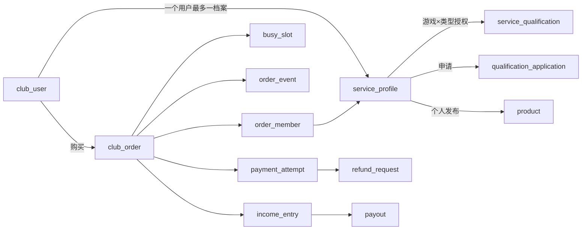

# 诺曼部落 · 数据库维护手册与字段字典

| 项目 | 当前基线 |
|---|---|
| 对应产品版本 | **1.0.1**，前后端均未正式发布 |
| 结构版本 | **Flyway V5**，和产品版本独立 |
| 核对日期 / 初始源码基线 | 2026-10-26，Asia/Shanghai / `33695dc` |
| 数据库 | MySQL 8.4；云端私有验收业务库 `norman_acceptance` |
| 覆盖范围 | **24张业务表** + **1张Flyway迁移历史表**；逐项字段、主键、唯一约束、外键、索引和用途 |
| 配套手册 | [前端](FRONTEND.md) · [后端](BACKEND.md) |

## 版本与维护方式

未正式发布前，数据库对应的产品功能版本保持 **1.0.1**。数据库结构每次变更使用新的 Flyway 迁移编号，不能修改已执行迁移的历史含义，也不能把V5理解为产品5.0。新增字段或约束时在本文更新表结构，并在文末记录“日期、迁移编号、业务意义、历史数据处理、发布顺序”。正式发布时和前后端手册一起冻结到 `docs/releases/1.0.1/`；下一产品版本由所有者指定。

本文结构来自仓库 V1～V5 迁移、Mapper 与 Service。云端在本次文档建立前已核验到V5。本次整理没有改库、导出业务数据或读取/保存账号口令。行数、用户名称和某笔订单是否存在是运行数据，不作为产品版本快照。

## 先理解主键、唯一键和关联

| 名词 | 含义 | 本项目例子 |
|---|---|---|
| 主键 PK | 唯一标识一行，不重复、不为NULL；每张表一组主键 | `club_order.id` 标识一笔订单 |
| 联合主键 | 多个字段组合后才唯一，单独一个字段可以重复 | `service_qualification(player_id,service_type,game_id)` 允许同成员有六种独立授权 |
| 唯一约束 UK | 防止一项业务重复，不一定是主键；MySQL可空唯一字段允许多个NULL | `income_entry(order_id,player_id)` 防止同单同人重复记账 |
| 外键 FK | 数据库强制被关联的父行存在 | `order_member.order_id → club_order.id` |
| 逻辑关联 | 代码按ID连接，但数据库没有建立FK，不能把它误写成外键 | `club_order.product_id → product.id` |
| 普通索引 IDX | 加速特定查询，不限制重复，不是主键 | 订单的 `status,service_type,game_id,created_at` 索引 |
| CHECK | 数据库检查值范围/组合；不能替代服务端归属权限 | copies必须1～99；官方商品的user_id/player_id必须为空 |
| 快照 | 下单时复制的名称、价格、规则，不随原资料变化 | `boss_name/product_title/unit_price/commission_bps` |

表名是数据库用的 snake_case；HTTP和Java通常映射为camelCase，例如 `preferred_player_id → preferredPlayerId`。所有业务金额为整数**分**，费率为基点（2000=20%），业务时间为Unix毫秒；`flyway_schema_history.installed_on` 使用SQL时间戳。`VARCHAR`中的长度是字符数约束；更严格的业务限制在后端接口执行。类型按迁移中的声明记载，MySQL查看时可能将BOOLEAN显示为tinyint(1)。

以下“可空/默认”中：可空表示NULL有效；“未设默认”不代表自动填零。主键不为空。JSON数组/对象目前存为VARCHAR/TEXT，不是MySQL原生JSON列。密码哈希、身份密文、token哈希等只说明用途，不列真实值。

## 存储位置与账号体系

| 名称 | 是什么 |
|---|---|
| RDS | 独立数据库服务，保存业务数据；应用通过内网TLS连接 |
| DMS | 浏览器中的查表/SQL管理工具，不是另一个业务数据库 |
| `norman_acceptance` | 当前云端独立验收库；生产应使用单独的正式库和正常认证 |
| `norman_service` | 应用连接RDS用的普通数据库账号，当前无ALTER权限，不是打手或后台账号 |
| `norman_app` | 数据库管理账号，不供网页业务登录，也不供应用日常连接 |
| `norman_app_manager` | `staff_account.username`，网页登录最高权限管理员，和前两者完全不同 |

当前未使用Redis；旧应用服务器上的MySQL和Adminer已移除。公共池只是内存查询缓存，完整订单仍在club_order；登录、限流和任务也在RDS，不靠缓存保存唯一副本。

## 迁移来源

| 迁移 | 结构/数据变化 | 当前维护关注点 |
|---|---|---|
| V1 `initial_schema.sql` | 创建24张业务表、基本索引与约束 | 基础字段和关系来源 |
| V2 `reporting_indexes.sql` | 新增订单创建/支付/游戏统计及成员收入索引 | 不修改金额或状态 |
| V3 `club_products.sql` | 商品user_id/player_id允许NULL；新增seller_type及组合约束；预置三个游戏×两种官方商品 | 官方没有虚构注册用户；初始组队6800分/小时、护航12800分/份，当前价格以实际行数据为准 |
| V4 `V4__Per_game_applications.java` | 拆分历史进行中的多游戏申请为单游戏申请，active_key按用户:类型:游戏 | 已处理历史和已授予权限保留；并未新增一张游戏表 |
| V5 `V5__Order_copies.java` | 订单新增copies默认1与1～99的CHECK；支持管理员预建DDL后应用登记迁移 | 不重算历史quantity、金额、收入或结算 |

SQL迁移位于 [resources/db/migration](../../server/src/main/resources/db/migration/)，Java迁移位于 [java/db/migration](../../server/src/main/java/db/migration/)。

## 业务表索引

| 模块 | 表 | 作用 | 主键 |
|---|---|---|---|
| 用户/认证 | [`club_user`](#club-user) | 注册用户 | `id` |
| 用户/认证 | [`login_identity`](#login-identity) | 用户登录身份 | `id` |
| 用户/认证 | [`staff_account`](#staff-account) | 后台员工账号 | `id` |
| 用户/认证 | [`auth_session`](#auth-session) | 登录会话 | `token_hash` |
| 用户/认证 | [`sms_code`](#sms-code) | 短信验证码 | `phone_hash` |
| 用户/认证 | [`auth_challenge`](#auth-challenge) | 历史员工认证挑战 | `token_hash` |
| 安全 | [`security_bucket`](#security-bucket) | 安全限流窗口 | `bucket_key` |
| 安全 | [`ip_ban`](#ip-ban) | IP 封禁 | `ip` |
| 服务/入驻 | [`service_profile`](#service-profile) | 用户服务档案 | `id` |
| 服务/入驻 | [`service_qualification`](#service-qualification) | 按游戏与服务类型的入驻授权 | `player_id, service_type, game_id` |
| 服务/入驻 | [`qualification_application`](#qualification-application) | 入驻申请与考核 | `id` |
| 商品 | [`product`](#product) | 服务商品 | `id` |
| 订单 | [`club_order`](#club-order) | 业务订单 | `id` |
| 订单 | [`order_member`](#order-member) | 订单协作成员 | `order_id, player_id` |
| 订单 | [`busy_slot`](#busy-slot) | 成员占单容量 | `player_id` |
| 订单 | [`order_event`](#order-event) | 订单时间线 | `id` |
| 资金 | [`payment_attempt`](#payment-attempt) | 支付尝试 | `id` |
| 资金 | [`payment_notification`](#payment-notification) | 已处理支付通知 | `event_key` |
| 资金 | [`refund_request`](#refund-request) | 退款申请 | `id` |
| 资金 | [`income_entry`](#income-entry) | 成员收入记账 | `id` |
| 资金 | [`payout`](#payout) | 成员转账记录 | `id` |
| 运维 | [`background_task`](#background-task) | 持久化后台任务 | `id` |
| 运维 | [`audit_log`](#audit-log) | 全局操作审计 | `id` |
| 订单 | [`idempotency_request`](#idempotency-request) | 订单创建幂等记录 | `owner_id, request_key` |

## 主要关系与读法



图用于阅读业务流，不替代逐表FK清单。例如商品与订单、收入与成员在业务上有关联，但并非所有方向都声明数据库外键。下列“数据库约束”按迁移原文保留，便于直接对照SHOW CREATE TABLE。

## 字段字典

<a id="club-user"></a>

### 1. `club_user` — 注册用户

所有老板与服务成员共用的业务用户；登录方式另存在 login_identity。

主键：`(id)`。

| 字段 | 类型 | 可空 / 默认 | 键 | 业务意义 |
|---|---|---|---|---|
| `id` | `VARCHAR(48)` | 非空；未设默认 | PK | 内部用户 ID；订单买家等关联此 ID，不是手机号。 |
| `name` | `VARCHAR(60)` | 非空；未设默认 | — | 用户显示名称。 |
| `disabled` | `BOOLEAN` | 非空；默认`FALSE` | — | 账号是否停用；停用时撤销 user 会话。 |
| `created_at` | `BIGINT` | 非空；未设默认 | — | 用户创建时间。 |

数据库约束与索引：

- 主键已单独列出；外键实现可能隐式建立支撑索引，实际索引名以 `SHOW INDEX` 为准。

<a id="login-identity"></a>

### 2. `login_identity` — 用户登录身份

将手机号身份与内部业务用户解耦；当前实际实现 provider=phone，微信身份尚未接入。

主键：`(id)`。

| 字段 | 类型 | 可空 / 默认 | 键 | 业务意义 |
|---|---|---|---|---|
| `id` | `VARCHAR(48)` | 非空；未设默认 | PK | 登录身份记录 ID。 |
| `user_id` | `VARCHAR(48)` | 非空；未设默认 | FK | 所属用户 ID。 |
| `provider` | `VARCHAR(24)` | 非空；未设默认 | — | 身份提供方；当前为 phone。 |
| `app_id` | `VARCHAR(80)` | 非空；默认`''` | — | 身份所属应用，手机号当前为空字符串；预留不同应用身份区分。 |
| `subject_hash` | `VARCHAR(64)` | 非空；未设默认 | — | 登录标识的 HMAC-SHA256，用于索引查找；不能当手机号明文。 |
| `subject_cipher` | `TEXT` | 非空；未设默认 | — | 登录标识的 AES-GCM 密文；当前加密手机号，依赖服务器密钥。 |
| `masked_value` | `VARCHAR(32)` | 非空；未设默认 | — | 可显示的脱敏值，例如手机号掩码。 |
| `created_at` | `BIGINT` | 非空；未设默认 | — | 绑定/创建时间。 |

数据库约束与索引：

- `CONSTRAINT uk_identity UNIQUE(provider,app_id,subject_hash)`。
- `FOREIGN KEY(user_id) REFERENCES club_user(id)`。
- 主键已单独列出；外键实现可能隐式建立支撑索引，实际索引名以 `SHOW INDEX` 为准。

<a id="staff-account"></a>

### 3. `staff_account` — 后台员工账号

管理后台账号体系，与普通用户和 RDS 数据库账号分别独立。当前使用 norman_app_manager。

主键：`(id)`。

| 字段 | 类型 | 可空 / 默认 | 键 | 业务意义 |
|---|---|---|---|---|
| `id` | `VARCHAR(48)` | 非空；未设默认 | PK | 内部员工 ID；不是数据库账号 ID。 |
| `username` | `VARCHAR(64)` | 非空；未设默认 | UK | 唯一登录账号名，创建时转为小写。 |
| `name` | `VARCHAR(60)` | 非空；未设默认 | — | 员工显示名称。 |
| `password_hash` | `VARCHAR(200)` | 非空；未设默认 | — | BCrypt cost=12 密码哈希；不是可解密的密码，API 不返回。 |
| `role` | `VARCHAR(24)` | 非空；未设默认 | — | admin / customer_service / finance。 |
| `disabled` | `BOOLEAN` | 非空；默认`FALSE` | — | 是否停用；停用会撤销员工会话和认证挑战。 |
| `totp_cipher` | `TEXT` | 可空；未设默认 | — | 历史验证器密钥密文；当前密码登录不使用，保留兼容字段。 |
| `last_totp_step` | `BIGINT` | 非空；默认`-1` | — | 历史 TOTP 防重放时间步，默认 -1；当前登录流程不使用。 |
| `created_at` | `BIGINT` | 非空；未设默认 | — | 员工创建时间。 |

数据库约束与索引：

- `CONSTRAINT ck_staff_role CHECK(role IN ('admin','customer_service','finance'))`。
- `username` 单列唯一约束。
- 主键已单独列出；外键实现可能隐式建立支撑索引，实际索引名以 `SHOW INDEX` 为准。

<a id="auth-session"></a>

### 4. `auth_session` — 登录会话

同时保存用户与员工会话；audience 决定 account_id 指向哪一种账号，没有数据库跨表外键。

主键：`(token_hash)`。

| 字段 | 类型 | 可空 / 默认 | 键 | 业务意义 |
|---|---|---|---|---|
| `token_hash` | `VARCHAR(64)` | 非空；未设默认 | PK | 随机会话 token 的 SHA-256 哈希；原始 token 不落库。 |
| `account_id` | `VARCHAR(48)` | 非空；未设默认 | — | user 会话关联 club_user.id；staff 会话关联 staff_account.id，逻辑关联。 |
| `audience` | `VARCHAR(12)` | 非空；未设默认 | — | user 或 staff，隔离两端会话。 |
| `csrf_hash` | `VARCHAR(64)` | 非空；未设默认 | — | 当前会话 CSRF token 的 SHA-256 哈希。 |
| `bearer` | `BOOLEAN` | 非空；未设默认 | — | true 表示用户 Bearer 会话；false 表示 Cookie 会话；员工仅 Cookie。 |
| `expires_at` | `BIGINT` | 非空；未设默认 | — | 绝对到期时间；用户7天、员工最长8小时。 |
| `last_seen_at` | `BIGINT` | 非空；未设默认 | — | 最近活动时间，节流写入；用于员工30分钟无活动失效。 |
| `created_at` | `BIGINT` | 非空；未设默认 | — | 会话签发时间。 |

数据库约束与索引：

- 普通索引 `ix_session_account(account_id,audience)`。
- 普通索引 `ix_session_expiry(expires_at)`。
- 主键已单独列出；外键实现可能隐式建立支撑索引，实际索引名以 `SHOW INDEX` 为准。

<a id="sms-code"></a>

### 5. `sms_code` — 短信验证码

每个手机号索引保留当前一份验证码状态，不保留明文验证码。

主键：`(phone_hash)`。

| 字段 | 类型 | 可空 / 默认 | 键 | 业务意义 |
|---|---|---|---|---|
| `phone_hash` | `VARCHAR(64)` | 非空；未设默认 | PK | 手机号的 HMAC 索引，同时是该手机号验证码记录主键。 |
| `code_hash` | `VARCHAR(64)` | 非空；未设默认 | — | 与手机号绑定的验证码 HMAC。 |
| `attempts` | `INT` | 非空；默认`0` | — | 当前验证码校验错误次数；达到5次消耗失效。 |
| `sent_at` | `BIGINT` | 非空；未设默认 | — | 发送成功后的写入时间。 |
| `expires_at` | `BIGINT` | 非空；未设默认 | — | 验证码到期时间，发送后5分钟。 |
| `consumed` | `BOOLEAN` | 非空；默认`FALSE` | — | 是否已使用/失效；成功登录不能再次使用。 |

数据库约束与索引：

- 主键已单独列出；外键实现可能隐式建立支撑索引，实际索引名以 `SHOW INDEX` 为准。

<a id="auth-challenge"></a>

### 6. `auth_challenge` — 历史员工认证挑战

为历史 TOTP/设置挑战保留的数据结构；当前没有对外绑定或验证接口，登录/停用会清理。

主键：`(token_hash)`。

| 字段 | 类型 | 可空 / 默认 | 键 | 业务意义 |
|---|---|---|---|---|
| `token_hash` | `VARCHAR(64)` | 非空；未设默认 | PK | 挑战随机 token 的哈希。 |
| `staff_id` | `VARCHAR(48)` | 非空；未设默认 | FK | 所属员工账号。 |
| `setup_cipher` | `TEXT` | 可空；未设默认 | — | 历史设置过程中的加密认证材料，可空。 |
| `attempts` | `INT` | 非空；默认`0` | — | 挑战尝试次数。 |
| `expires_at` | `BIGINT` | 非空；未设默认 | — | 挑战失效时间。 |
| `consumed` | `BOOLEAN` | 非空；默认`FALSE` | — | 挑战是否已被使用。 |

数据库约束与索引：

- `FOREIGN KEY(staff_id) REFERENCES staff_account(id)`。
- 主键已单独列出；外键实现可能隐式建立支撑索引，实际索引名以 `SHOW INDEX` 为准。

<a id="security-bucket"></a>

### 7. `security_bucket` — 安全限流窗口

承载 API、登录、短信等固定时间窗口的计数；独立事务更新，不随业务失败回滚。

主键：`(bucket_key)`。

| 字段 | 类型 | 可空 / 默认 | 键 | 业务意义 |
|---|---|---|---|---|
| `bucket_key` | `VARCHAR(120)` | 非空；未设默认 | PK | 用途前缀 + 身份 HMAC，例如按手机号/IP/账号的限流键。 |
| `hits` | `INT` | 非空；未设默认 | — | 窗口内命中次数，超过限制后仍以受限上限记录。 |
| `window_end` | `BIGINT` | 非空；未设默认 | — | 当前窗口结束时间；超过后下次请求重置。 |

数据库约束与索引：

- 普通索引 `ix_bucket_expiry(window_end)`。
- 主键已单独列出；外键实现可能隐式建立支撑索引，实际索引名以 `SHOW INDEX` 为准。

<a id="ip-ban"></a>

### 8. `ip_ban` — IP 封禁

同一规范化 IP 一条当前记录；可自动临时封禁、管理员封禁或解除，操作另记审计。

主键：`(ip)`。

| 字段 | 类型 | 可空 / 默认 | 键 | 业务意义 |
|---|---|---|---|---|
| `ip` | `VARCHAR(64)` | 非空；未设默认 | PK | 规范化 IPv4/IPv6 字面地址；不接受主机名。 |
| `reason` | `VARCHAR(200)` | 非空；未设默认 | — | 封禁原因。 |
| `expires_at` | `BIGINT` | 非空；未设默认 | — | 到此时间后不再拦截。 |
| `created_at` | `BIGINT` | 非空；未设默认 | — | 最近创建/更新该封禁的时间。 |
| `actor` | `VARCHAR(60)` | 非空；未设默认 | — | 操作人名称或系统标记，不是员工外键。 |
| `revoked` | `BOOLEAN` | 非空；默认`FALSE` | — | 是否提前解除；解除通常更新此标记，而非删除历史审计。 |

数据库约束与索引：

- 主键已单独列出；外键实现可能隐式建立支撑索引，实际索引名以 `SHOW INDEX` 为准。

<a id="service-profile"></a>

### 9. `service_profile` — 用户服务档案

一用户最多一份档案；新用户也有档案，但未通过入驻，不等于已经可以接单。

主键：`(id)`。

| 字段 | 类型 | 可空 / 默认 | 键 | 业务意义 |
|---|---|---|---|---|
| `id` | `VARCHAR(48)` | 非空；未设默认 | PK | 服务档案/成员 ID，订单中的 playerId 使用它。 |
| `user_id` | `VARCHAR(48)` | 非空；未设默认 | UK / FK | 所属业务用户 ID，唯一，建立一对一关系。 |
| `name` | `VARCHAR(60)` | 非空；未设默认 | — | 成员显示名称。 |
| `subtitle` | `VARCHAR(120)` | 非空；未设默认 | — | 短介绍/档案副标题。 |
| `game_ids` | `VARCHAR(500)` | 非空；未设默认 | — | 擅长游戏 ID 的 JSON 数组文本；不是实际授权列表。 |
| `tags` | `VARCHAR(500)` | 非空；未设默认 | — | 档案标签 JSON 数组文本。 |
| `rating` | `DECIMAL(4,2)` | 非空；默认`5` | — | 档案评分，当前没有完整评价提交/自动更新体系。 |
| `completed` | `INT` | 非空；默认`0` | — | 档案历史完成量，当前不是随每单自动维护的可信统计。 |
| `price` | `INT` | 非空；默认`6800` | — | 档案建议小时价，单位分；实际购买使用 product.price。 |
| `color` | `VARCHAR(12)` | 非空；未设默认 | — | 头像/档案颜色，例如十六进制色值。 |
| `avatar` | `VARCHAR(12)` | 非空；未设默认 | — | 头像字形/短标识，当前不是上传图片 URL。 |
| `available` | `BOOLEAN` | 非空；默认`FALSE` | — | 平台接单启用标志，仅管理员能设置，打手无权修改；false 在用户端显示服务中/暂停接新单，不代表设备离线。 |
| `approved` | `BOOLEAN` | 非空；默认`FALSE` | — | 是否启用认证档案；false 时已有授权不能用于新发布/接单。 |
| `bio` | `VARCHAR(500)` | 非空；未设默认 | — | 长介绍。 |
| `created_at` | `BIGINT` | 非空；未设默认 | — | 档案创建时间。 |

数据库约束与索引：

- `FOREIGN KEY(user_id) REFERENCES club_user(id)`。
- `CONSTRAINT ck_profile_price CHECK(price BETWEEN 100 AND 100000)`。
- `user_id` 单列唯一约束。
- 主键已单独列出；外键实现可能隐式建立支撑索引，实际索引名以 `SHOW INDEX` 为准。

<a id="service-qualification"></a>

### 10. `service_qualification` — 按游戏与服务类型的入驻授权

真正决定能发布/接取哪个游戏、哪类订单；同一成员可以有多个独立项目。

主键：`(player_id, service_type, game_id)`。

| 字段 | 类型 | 可空 / 默认 | 键 | 业务意义 |
|---|---|---|---|---|
| `player_id` | `VARCHAR(48)` | 非空；未设默认 | 联合PK / FK | 获授权的服务成员。 |
| `service_type` | `VARCHAR(12)` | 非空；未设默认 | 联合PK | hourly=组队；escort=护航。 |
| `game_id` | `VARCHAR(24)` | 非空；未设默认 | 联合PK | 该项授权的游戏 ID。 |
| `granted_at` | `BIGINT` | 非空；未设默认 | — | 考核通过并授予该项的时间。 |

数据库约束与索引：

- `PRIMARY KEY(player_id,service_type,game_id)`。
- `FOREIGN KEY(player_id) REFERENCES service_profile(id)`。
- `CONSTRAINT ck_qualification_type CHECK(service_type IN ('hourly','escort'))`。
- 主键已单独列出；外键实现可能隐式建立支撑索引，实际索引名以 `SHOW INDEX` 为准。

<a id="qualification-application"></a>

### 11. `qualification_application` — 入驻申请与考核

一行是某用户某游戏某类型的一次申请；拒绝后可重新申请，历史记录保留。

主键：`(id)`。

| 字段 | 类型 | 可空 / 默认 | 键 | 业务意义 |
|---|---|---|---|---|
| `id` | `VARCHAR(48)` | 非空；未设默认 | PK | 申请记录 ID。 |
| `user_id` | `VARCHAR(48)` | 非空；未设默认 | FK | 申请人的业务用户。 |
| `player_id` | `VARCHAR(48)` | 非空；未设默认 | FK | 对应服务档案。 |
| `name` | `VARCHAR(60)` | 非空；未设默认 | — | 申请时名称快照。 |
| `service_type` | `VARCHAR(12)` | 非空；未设默认 | — | 申请组队 hourly 或护航 escort。 |
| `game_ids` | `VARCHAR(500)` | 非空；未设默认 | — | JSON 数组文本；当前新申请严格一个游戏。 |
| `introduction` | `VARCHAR(500)` | 非空；未设默认 | — | 经验与说明，接口要求10～500字。 |
| `status` | `VARCHAR(16)` | 非空；未设默认 | — | pending资料待审 / assessment考核中 / approved通过 / rejected拒绝。 |
| `active_key` | `VARCHAR(120)` | 可空；未设默认 | UK | 进行中去重键“用户:类型:游戏”；处理中唯一，处理完成后置NULL。 |
| `score` | `INT` | 可空；未设默认 | — | 考核成绩，可空；通过要求60～100。 |
| `review_note` | `VARCHAR(500)` | 可空；未设默认 | — | 审核/考核反馈，可空。 |
| `created_at` | `BIGINT` | 非空；未设默认 | — | 提交时间。 |
| `reviewed_at` | `BIGINT` | 可空；未设默认 | — | 最近一次审核/考核处理时间，可空。 |

数据库约束与索引：

- `FOREIGN KEY(user_id) REFERENCES club_user(id)`。
- `FOREIGN KEY(player_id) REFERENCES service_profile(id)`。
- `active_key` 单列唯一约束。
- 普通索引 `ix_application_user(user_id,created_at)`。
- 主键已单独列出；外键实现可能隐式建立支撑索引，实际索引名以 `SHOW INDEX` 为准。

<a id="product"></a>

### 12. `product` — 服务商品

长期服务目录；上下架控制能否新下单，不因已有订单、忙碌或完成一单而自动消耗。

主键：`(id)`。

| 字段 | 类型 | 可空 / 默认 | 键 | 业务意义 |
|---|---|---|---|---|
| `id` | `VARCHAR(48)` | 非空；未设默认 | PK | 商品 ID；官方为固定 club-类型-游戏，个人新建为 SP_ 前缀。 |
| `user_id` | `VARCHAR(48)` | 可空；未设默认 | FK | 个人商品所属用户；V3起官方商品必须NULL。 |
| `player_id` | `VARCHAR(48)` | 可空；未设默认 | FK | 个人商品服务提供者；V3起官方商品必须NULL。 |
| `seller_name` | `VARCHAR(60)` | 非空；未设默认 | — | 发布者名称快照；官方为诺曼部落。 |
| `game_id` | `VARCHAR(24)` | 非空；未设默认 | — | 商品游戏。 |
| `service_type` | `VARCHAR(12)` | 非空；未设默认 | — | hourly组队 / escort护航。 |
| `title` | `VARCHAR(40)` | 非空；未设默认 | — | 商品业务标题，2～40字；当前卡片主标题显示发布者，不等于不保存此字段。 |
| `description` | `VARCHAR(200)` | 非空；未设默认 | — | 服务说明，接口5～200字。 |
| `price` | `INT` | 非空；未设默认 | — | 商品单价，100～100000分；组队每小时/护航每份，买家不能改价。 |
| `task` | `VARCHAR(200)` | 非空；未设默认 | — | 护航任务，1～200字；组队固定空字符串。 |
| `active` | `BOOLEAN` | 非空；未设默认 | — | 是否在售；下架禁止新下单和未支付商品订单付款。 |
| `created_at` | `BIGINT` | 非空；未设默认 | — | 发布时间；V3预置官方商品为0。 |
| `seller_type` | `VARCHAR(12)` | 非空；默认`'member'` | — | V3新增；member个人 / club官方，默认member；决定公共或指定订单路径。 |

数据库约束与索引：

- `FOREIGN KEY(user_id) REFERENCES club_user(id)`。
- `FOREIGN KEY(player_id) REFERENCES service_profile(id)`。
- `CONSTRAINT ck_product_price CHECK(price BETWEEN 100 AND 100000)`。
- `CONSTRAINT ck_product_type CHECK(service_type IN ('hourly','escort'))`。
- `CONSTRAINT ck_product_seller CHECK ((seller_type='club' AND user_id IS NULL AND player_id IS NULL) OR (seller_type='member' AND user_id IS NOT NULL AND player_id IS NOT NULL))`。
- 普通索引 `ix_product_catalog(active,game_id,service_type,created_at)`。
- 主键已单独列出；外键实现可能隐式建立支撑索引，实际索引名以 `SHOW INDEX` 为准。

<a id="club-order"></a>

### 13. `club_order` — 业务订单

购买时保存商品、身份、价格和规则快照；一单可购买多份，历史金额不跟随商品变化。

主键：`(id)`。

| 字段 | 类型 | 可空 / 默认 | 键 | 业务意义 |
|---|---|---|---|---|
| `id` | `VARCHAR(48)` | 非空；未设默认 | PK | 订单号，主键，通常NC_前缀。 |
| `product_id` | `VARCHAR(48)` | 可空；未设默认 | — | 来源商品 ID，逻辑关联，无数据库外键；兼容早期订单可空。 |
| `product_title` | `VARCHAR(40)` | 可空；未设默认 | — | 下单时的商品标题快照，可空。 |
| `boss_id` | `VARCHAR(48)` | 非空；未设默认 | FK | 下单用户 ID；老板也是普通注册用户。 |
| `boss_name` | `VARCHAR(60)` | 非空；未设默认 | — | 下单时名称快照。 |
| `game_id` | `VARCHAR(24)` | 非空；未设默认 | — | 游戏 ID 快照。 |
| `game_name` | `VARCHAR(40)` | 非空；未设默认 | — | 游戏名称快照。 |
| `region` | `VARCHAR(40)` | 非空；未设默认 | — | 游戏区服快照。 |
| `service_type` | `VARCHAR(12)` | 非空；未设默认 | — | hourly组队 / escort护航，服务端检查。 |
| `task` | `VARCHAR(200)` | 非空；未设默认 | — | 每份护航任务快照；组队空字符串。 |
| `task_completed` | `BOOLEAN` | 非空；默认`FALSE` | — | 是否确认全部份数的护航任务完成，默认false。 |
| `preferred_player_id` | `VARCHAR(48)` | 可空；未设默认 | — | 下单指定的目标成员，逻辑关联service_profile；官方公共单为NULL。 |
| `preferred_player_name` | `VARCHAR(60)` | 可空；未设默认 | — | 指定成员名称快照。 |
| `player_id` | `VARCHAR(48)` | 可空；未设默认 | — | 实际接单负责人；等待接单时为NULL，不等同指定目标。 |
| `player_name` | `VARCHAR(60)` | 可空；未设默认 | — | 实际负责人名称快照。 |
| `unit_price` | `INT` | 非空；未设默认 | — | 商品单价快照，单位分。 |
| `quantity` | `INT` | 非空；未设默认 | — | 每份组队小时数1～8；护航每份为1。 |
| `amount` | `INT` | 非空；未设默认 | — | 订单总金额分=unit_price×quantity×copies；不是单份价格。 |
| `commission_bps` | `INT` | 非空；未设默认 | — | 下单时服务费快照；当前2000表示20%，10000为100%。 |
| `earnings` | `INT` | 非空；未设默认 | — | 整单预计净收入分；确认退款后按净额和原费率重算，不等于单个人份额。 |
| `status` | `VARCHAR(16)` | 非空；未设默认 | — | unpaid/waiting/accepted/serving/confirming/completed/cancelled。 |
| `refund_status` | `VARCHAR(16)` | 非空；默认`'none'` | — | none/pending/processing/refunded/rejected；独立于履约状态。 |
| `refund_id` | `VARCHAR(48)` | 可空；未设默认 | — | 最近/当前退款申请ID，逻辑关联refund_request。 |
| `refund_reason` | `VARCHAR(200)` | 可空；未设默认 | — | 退款原因快照，可空；空提交时服务端使用默认说明。 |
| `refund_amount` | `INT` | 可空；未设默认 | — | 退款申请/已确认金额分，可空；仅refunded时计入确认退款扣减。 |
| `refund_review_note` | `VARCHAR(500)` | 可空；未设默认 | — | 退款审核说明快照，可空。 |
| `note` | `VARCHAR(200)` | 非空；未设默认 | — | 买家补充说明，最多200字，允许空字符串。 |
| `created_at` | `BIGINT` | 非空；未设默认 | — | 创建时间。 |
| `expires_at` | `BIGINT` | 非空；未设默认 | — | 待支付截止时间，创建后10分钟。 |
| `paid_at` | `BIGINT` | 可空；未设默认 | — | 服务端核验收款时间；NULL不能进入待接公共单。 |
| `started_at` | `BIGINT` | 可空；未设默认 | — | 服务开始时间，组队计时依据。 |
| `finished_at` | `BIGINT` | 可空；未设默认 | — | 买家确认完成时间；不是负责人提交验收的时间。 |
| `payment_id` | `VARCHAR(48)` | 可空；未设默认 | — | 确认成功的支付尝试ID，逻辑关联payment_attempt。 |
| `settlement_id` | `VARCHAR(48)` | 可空；未设默认 | — | 首个关联收入记录ID，逻辑关联income_entry；每人具体记录看order_member。 |
| `version` | `BIGINT` | 非空；默认`0` | — | 并发版本计数，更新时WHERE同时检查旧值并+1。 |
| `copies` | `INT` | 非空；默认`1` | — | V5新增，整数1～99默认1；同一订单购买份数；旧订单补1。 |

数据库约束与索引：

- `FOREIGN KEY(boss_id) REFERENCES club_user(id)`。
- `CONSTRAINT ck_order_amount CHECK(amount>0 AND earnings>=0 AND earnings<=amount)`。
- `CONSTRAINT ck_order_quantity CHECK(quantity BETWEEN 1 AND 8)`。
- `CONSTRAINT ck_order_fee CHECK(commission_bps BETWEEN 0 AND 10000)`。
- `CONSTRAINT ck_order_status CHECK(status IN ('unpaid','waiting','accepted','serving','confirming','completed','cancelled'))`。
- `CONSTRAINT ck_order_copies CHECK(copies BETWEEN 1 AND 99)`。
- 普通索引 `ix_order_owner(boss_id,created_at)`。
- 普通索引 `ix_order_hall(status,service_type,game_id,created_at)`。
- 普通索引 `ix_order_invitation(preferred_player_id,status)`。
- 普通索引 `ix_order_expiry(status,expires_at)`。
- 普通索引 `ix_order_created(created_at)`。
- 普通索引 `ix_order_paid(paid_at)`。
- 普通索引 `ix_order_game_paid(game_id,paid_at)`。
- 主键已单独列出；外键实现可能隐式建立支撑索引，实际索引名以 `SHOW INDEX` 为准。

<a id="order-member"></a>

### 14. `order_member` — 订单协作成员

负责人和副手都记录在这里，是订单参与权及分账名单的依据。

主键：`(order_id, player_id)`。

| 字段 | 类型 | 可空 / 默认 | 键 | 业务意义 |
|---|---|---|---|---|
| `order_id` | `VARCHAR(48)` | 非空；未设默认 | 联合PK / FK | 所属订单。 |
| `player_id` | `VARCHAR(48)` | 非空；未设默认 | 联合PK / FK | 参与服务成员。 |
| `name` | `VARCHAR(60)` | 非空；未设默认 | — | 参与时的名称快照。 |
| `position` | `INT` | 非空；未设默认 | — | 名单顺序；0为负责人，副手按序；分账尾差也按该顺序。 |
| `settlement_id` | `VARCHAR(48)` | 可空；未设默认 | — | 该成员本订单的收入记录ID，逻辑关联income_entry，可空。 |

数据库约束与索引：

- `PRIMARY KEY(order_id,player_id)`。
- `CONSTRAINT uk_member_position UNIQUE(order_id,position)`。
- `FOREIGN KEY(order_id) REFERENCES club_order(id)`。
- `FOREIGN KEY(player_id) REFERENCES service_profile(id)`。
- 普通索引 `ix_member_player(player_id,order_id)`。
- 主键已单独列出；外键实现可能隐式建立支撑索引，实际索引名以 `SHOW INDEX` 为准。

<a id="busy-slot"></a>

### 15. `busy_slot` — 成员占单容量

一位成员最多一行占单；负责人/副手均占用，防止并发接入多个未结束服务。

主键：`(player_id)`。

| 字段 | 类型 | 可空 / 默认 | 键 | 业务意义 |
|---|---|---|---|---|
| `player_id` | `VARCHAR(48)` | 非空；未设默认 | PK / FK | 被占用的成员；主键直接保证一人只有一个容量占位。 |
| `order_id` | `VARCHAR(48)` | 非空；未设默认 | FK | 占用其容量的订单；完成、全退、改派或移除副手时释放。 |

数据库约束与索引：

- `FOREIGN KEY(player_id) REFERENCES service_profile(id)`。
- `FOREIGN KEY(order_id) REFERENCES club_order(id)`。
- 主键已单独列出；外键实现可能隐式建立支撑索引，实际索引名以 `SHOW INDEX` 为准。

<a id="order-event"></a>

### 16. `order_event` — 订单时间线

用户和后台在订单详情看到的创建、支付、派单、履约、售后等动态。

主键：`(id)`。

| 字段 | 类型 | 可空 / 默认 | 键 | 业务意义 |
|---|---|---|---|---|
| `id` | `VARCHAR(48)` | 非空；未设默认 | PK | 事件ID。 |
| `order_id` | `VARCHAR(48)` | 非空；未设默认 | FK | 关联订单。 |
| `at` | `BIGINT` | 非空；未设默认 | — | 事件时间。 |
| `actor` | `VARCHAR(60)` | 非空；未设默认 | — | 操作人名称/系统，不是账号外键。 |
| `label` | `VARCHAR(120)` | 非空；未设默认 | — | 事件摘要。 |
| `note` | `VARCHAR(500)` | 可空；未设默认 | — | 补充说明，可空。 |

数据库约束与索引：

- `FOREIGN KEY(order_id) REFERENCES club_order(id)`。
- 普通索引 `ix_event_order(order_id,at)`。
- 主键已单独列出；外键实现可能隐式建立支撑索引，实际索引名以 `SHOW INDEX` 为准。

<a id="payment-attempt"></a>

### 17. `payment_attempt` — 支付尝试

支付与业务订单分表；一个订单可能有历史尝试，但只接受一个成功收款归属。

主键：`(id)`。

| 字段 | 类型 | 可空 / 默认 | 键 | 业务意义 |
|---|---|---|---|---|
| `id` | `VARCHAR(48)` | 非空；未设默认 | PK | 支付尝试ID，通常PAY_前缀。 |
| `order_id` | `VARCHAR(48)` | 非空；未设默认 | FK | 所属业务订单。 |
| `user_id` | `VARCHAR(48)` | 非空；未设默认 | — | 付款用户ID，逻辑关联club_user，无独立数据库外键。 |
| `channel` | `VARCHAR(24)` | 非空；未设默认 | — | wechat/alipay；acceptance只存在内部验收包。 |
| `request_key` | `VARCHAR(80)` | 非空；未设默认 | — | 创建支付的幂等键，与user_id联合唯一。 |
| `amount` | `INT` | 非空；未设默认 | — | 本次应付金额分，必须与订单金额一致。 |
| `currency` | `VARCHAR(8)` | 非空；未设默认 | — | 币种，当前CNY。 |
| `status` | `VARCHAR(24)` | 非空；未设默认 | — | creating/pending/paid/closed/late_paid/duplicate_paid；unknown是预留未决状态，现有代码也会据此保护取消。 |
| `transaction_id` | `VARCHAR(120)` | 可空；未设默认 | UK | 渠道交易号，唯一且可空，防重复渠道交易。 |
| `merchant_id` | `VARCHAR(120)` | 可空；未设默认 | — | 渠道确认的商户标识，可空。 |
| `client_params` | `TEXT` | 可空；未设默认 | — | JSON文本，客户端调起支付的参数；未创建时可空。 |
| `created_at` | `BIGINT` | 非空；未设默认 | — | 支付尝试创建时间。 |
| `updated_at` | `BIGINT` | 非空；未设默认 | — | 最近状态更新时间。 |

数据库约束与索引：

- `CONSTRAINT uk_payment_request UNIQUE(user_id,request_key)`。
- `FOREIGN KEY(order_id) REFERENCES club_order(id)`。
- `transaction_id` 单列唯一约束。
- 普通索引 `ix_payment_order(order_id,status)`。
- 主键已单独列出；外键实现可能隐式建立支撑索引，实际索引名以 `SHOW INDEX` 为准。

<a id="payment-notification"></a>

### 18. `payment_notification` — 已处理支付通知

用通知事件主键去重，避免重复回调多次记收款。

主键：`(event_key)`。

| 字段 | 类型 | 可空 / 默认 | 键 | 业务意义 |
|---|---|---|---|---|
| `event_key` | `VARCHAR(160)` | 非空；未设默认 | PK | 渠道名:通知事件ID，主键。 |
| `payment_id` | `VARCHAR(48)` | 非空；未设默认 | FK | 对应支付尝试。 |
| `received_at` | `BIGINT` | 非空；未设默认 | — | 服务端接受并记录该通知时间。 |

数据库约束与索引：

- `FOREIGN KEY(payment_id) REFERENCES payment_attempt(id)`。
- 主键已单独列出；外键实现可能隐式建立支撑索引，实际索引名以 `SHOW INDEX` 为准。

<a id="refund-request"></a>

### 19. `refund_request` — 退款申请

保留售后审核和渠道退款过程；订单上的refund字段是当前摘要。

主键：`(id)`。

| 字段 | 类型 | 可空 / 默认 | 键 | 业务意义 |
|---|---|---|---|---|
| `id` | `VARCHAR(48)` | 非空；未设默认 | PK | 退款申请ID，通常RF_前缀。 |
| `order_id` | `VARCHAR(48)` | 非空；未设默认 | FK | 所属订单。 |
| `payment_id` | `VARCHAR(48)` | 非空；未设默认 | FK | 原收款支付尝试，原路退款依据。 |
| `amount` | `INT` | 非空；未设默认 | — | 本次申请退款金额分，1～订单金额。 |
| `status` | `VARCHAR(24)` | 非空；未设默认 | — | pending待审 / processing渠道中 / rejected拒绝 / refunded已确认。 |
| `reason` | `VARCHAR(200)` | 非空；未设默认 | — | 原因；用户可不填，由服务端补默认文本后落库，所以字段本身非空。 |
| `review_note` | `VARCHAR(500)` | 可空；未设默认 | — | 审核说明，可空。 |
| `created_at` | `BIGINT` | 非空；未设默认 | — | 申请时间。 |
| `reviewed_at` | `BIGINT` | 可空；未设默认 | — | 审批处理时间，可空；不是渠道退款成功时间字段。 |
| `channel_refund_id` | `VARCHAR(120)` | 可空；未设默认 | UK | 渠道退款号，唯一且可空。 |

数据库约束与索引：

- `FOREIGN KEY(order_id) REFERENCES club_order(id)`。
- `FOREIGN KEY(payment_id) REFERENCES payment_attempt(id)`。
- `channel_refund_id` 单列唯一约束。
- 主键已单独列出；外键实现可能隐式建立支撑索引，实际索引名以 `SHOW INDEX` 为准。

<a id="income-entry"></a>

### 20. `income_entry` — 成员收入记账

每个订单每位成员最多一个收入份额；credited不代表真实款项已转到成员账户。

主键：`(id)`。

| 字段 | 类型 | 可空 / 默认 | 键 | 业务意义 |
|---|---|---|---|---|
| `id` | `VARCHAR(48)` | 非空；未设默认 | PK | 收入记录ID，通常INC_前缀；接口常称settlementId。 |
| `order_id` | `VARCHAR(48)` | 非空；未设默认 | FK | 来源订单。 |
| `player_id` | `VARCHAR(48)` | 非空；未设默认 | — | 收入所属成员ID，逻辑关联service_profile，无数据库外键。 |
| `player_name` | `VARCHAR(60)` | 非空；未设默认 | — | 记账时成员名称快照。 |
| `amount` | `INT` | 非空；未设默认 | — | 该成员分得金额分，不是全团队收入。 |
| `status` | `VARCHAR(16)` | 非空；未设默认 | — | 当前写credited已记账；paid为实际转账完成语义，当前正式转账尚未实现。 |
| `created_at` | `BIGINT` | 非空；未设默认 | — | 记账时间。 |
| `paid_at` | `BIGINT` | 可空；未设默认 | — | 真实转账确认时间，当前常为NULL。 |

数据库约束与索引：

- `CONSTRAINT uk_income_share UNIQUE(order_id,player_id)`。
- `FOREIGN KEY(order_id) REFERENCES club_order(id)`。
- `CONSTRAINT ck_income_amount CHECK(amount>=0)`。
- 普通索引 `ix_income_player(player_id,created_at)`。
- 主键已单独列出；外键实现可能隐式建立支撑索引，实际索引名以 `SHOW INDEX` 为准。

<a id="payout"></a>

### 21. `payout` — 成员转账记录

与收入一对一的真实打款待办；当前只创建awaiting_channel，不会真实转账。

主键：`(id)`。

| 字段 | 类型 | 可空 / 默认 | 键 | 业务意义 |
|---|---|---|---|---|
| `id` | `VARCHAR(48)` | 非空；未设默认 | PK | 转账待办ID，通常PO_前缀。 |
| `income_id` | `VARCHAR(48)` | 非空；未设默认 | UK / FK | 关联收入记录，唯一，避免同份收入重复创建转账。 |
| `amount` | `INT` | 非空；未设默认 | — | 待转账金额分，来源该成员收入份额。 |
| `status` | `VARCHAR(24)` | 非空；未设默认 | — | 当前awaiting_channel，表示等待转账渠道接入。 |
| `channel_reference` | `VARCHAR(120)` | 可空；未设默认 | UK | 渠道打款流水，唯一且可空。 |
| `created_at` | `BIGINT` | 非空；未设默认 | — | 转账待办创建时间。 |
| `updated_at` | `BIGINT` | 非空；未设默认 | — | 转账待办最近更新时间。 |

数据库约束与索引：

- `FOREIGN KEY(income_id) REFERENCES income_entry(id)`。
- `income_id` 单列唯一约束。
- `channel_reference` 单列唯一约束。
- 主键已单独列出；外键实现可能隐式建立支撑索引，实际索引名以 `SHOW INDEX` 为准。

<a id="background-task"></a>

### 22. `background_task` — 持久化后台任务

应用重启可继续处理任务；不是Redis队列。业务和入队在同一事务内完成。

主键：`(id)`。

| 字段 | 类型 | 可空 / 默认 | 键 | 业务意义 |
|---|---|---|---|---|
| `id` | `VARCHAR(48)` | 非空；未设默认 | PK | 任务ID，通常task_前缀。 |
| `type` | `VARCHAR(32)` | 非空；未设默认 | — | CLOSE_ORDER/PAYMENT_CREATE/PAYMENT_QUERY/REFUND/PAYOUT/PAYMENT_EXCEPTION。 |
| `aggregate_id` | `VARCHAR(48)` | 非空；未设默认 | — | 被处理对象ID，类型决定是订单、支付、退款或转账；逻辑关联，无多表外键。 |
| `state` | `VARCHAR(16)` | 非空；未设默认 | — | pending待执行/running租约中/done完成/blocked渠道未接/failed多次失败。 |
| `run_at` | `BIGINT` | 非空；未设默认 | — | 下次计划执行时间。 |
| `lease_until` | `BIGINT` | 可空；未设默认 | — | 当前执行租约截止时间，可空；超时可重新认领。 |
| `attempts` | `INT` | 非空；默认`0` | — | 已认领尝试次数；达到8次失败后不再普通重试。 |
| `last_error` | `VARCHAR(200)` | 可空；未设默认 | — | 脱敏的最近问题说明，可空，不存原始渠道异常或凭据。 |

数据库约束与索引：

- `CONSTRAINT uk_task_aggregate UNIQUE(type,aggregate_id)`。
- 普通索引 `ix_task_due(state,run_at,lease_until)`。
- 主键已单独列出；外键实现可能隐式建立支撑索引，实际索引名以 `SHOW INDEX` 为准。

<a id="audit-log"></a>

### 23. `audit_log` — 全局操作审计

后台工作动态和操作日志来源；与订单详情时间线分开保存。

主键：`(id)`。

| 字段 | 类型 | 可空 / 默认 | 键 | 业务意义 |
|---|---|---|---|---|
| `id` | `VARCHAR(48)` | 非空；未设默认 | PK | 审计记录ID。 |
| `at` | `BIGINT` | 非空；未设默认 | — | 操作时间。 |
| `actor` | `VARCHAR(60)` | 非空；未设默认 | — | 名称/系统标记，不是员工ID外键。 |
| `action` | `VARCHAR(80)` | 非空；未设默认 | — | 登录、审核、派单、记账、封禁等动作。 |
| `target` | `VARCHAR(120)` | 非空；未设默认 | — | 关联业务对象ID或IP等文本，可能不是订单，无数据库外键。 |
| `detail` | `VARCHAR(500)` | 非空；未设默认 | — | 脱敏操作说明，不应保存口令、验证码、密钥或完整SQL参数。 |

数据库约束与索引：

- 普通索引 `ix_audit_date(at)`。
- 主键已单独列出；外键实现可能隐式建立支撑索引，实际索引名以 `SHOW INDEX` 为准。

<a id="idempotency-request"></a>

### 24. `idempotency_request` — 订单创建幂等记录

同一用户重复提交同一请求号时返回原订单，避免网络重试创建多单。

主键：`(owner_id, request_key)`。

| 字段 | 类型 | 可空 / 默认 | 键 | 业务意义 |
|---|---|---|---|---|
| `owner_id` | `VARCHAR(48)` | 非空；未设默认 | 联合PK | 创建订单的用户ID，逻辑关联club_user。 |
| `request_key` | `VARCHAR(80)` | 非空；未设默认 | 联合PK | 客户端幂等请求键；与owner_id联合主键。 |
| `request_hash` | `VARCHAR(64)` | 非空；未设默认 | — | 请求体规范化后的SHA-256；同键不同内容返回409。 |
| `order_id` | `VARCHAR(48)` | 非空；未设默认 | FK | 第一次成功创建的订单。 |
| `created_at` | `BIGINT` | 非空；未设默认 | — | 幂等记录写入时间。 |

数据库约束与索引：

- `PRIMARY KEY(owner_id,request_key)`。
- `FOREIGN KEY(order_id) REFERENCES club_order(id)`。
- 主键已单独列出；外键实现可能隐式建立支撑索引，实际索引名以 `SHOW INDEX` 为准。

## Flyway系统表：`flyway_schema_history`

这是第25张表，由Flyway维护，业务接口不直接编辑。以下字段核对本项目打包使用的Flyway 12.4.0 MySQL建表定义；真实实例仍可用SHOW CREATE TABLE确认。不要手工删除、篡改成功状态或编造checksum以跳过迁移。

主键：`installed_rank`。success有普通查询索引。

| 字段 | 类型 | 可空 / 默认 | 意义 |
|---|---|---|---|
| `installed_rank` | `INT` | 非空；PK | 迁移记录安装顺序；不等于产品版本 |
| `version` | `VARCHAR(50)` | 可空 | 版本迁移编号；可重复迁移等特殊记录可能为空 |
| `description` | `VARCHAR(200)` | 非空 | 迁移描述 |
| `type` | `VARCHAR(20)` | 非空 | 迁移类型，例如SQL/JDBC；Java迁移也是有记录的 |
| `script` | `VARCHAR(1000)` | 非空 | SQL文件名或Java迁移类标识 |
| `checksum` | `INT` | 可空 | 已执行内容校验和，用于发现历史迁移变动 |
| `installed_by` | `VARCHAR(100)` | 非空 | 执行迁移的数据库账号 |
| `installed_on` | `TIMESTAMP` | 非空，默认CURRENT_TIMESTAMP | 安装时间，区别于业务表毫秒时间 |
| `execution_time` | `INT` | 非空 | 执行耗时，毫秒 |
| `success` | `BOOL` | 非空 | 是否成功，不应手动改值伪装通过 |

## 状态字典与易混淆字段

| 位置 | 值与含义 |
|---|---|
| `club_order.status` | unpaid待付款；waiting待接单；accepted待开始；serving服务中；confirming待买家确认；completed已完成；cancelled已取消 |
| `club_order.refund_status` | none无售后；pending待审核；processing渠道退款中；refunded已确认退款；rejected申请被拒 |
| `qualification_application.status` | pending资料待审；assessment专项考核；approved通过；rejected未通过 |
| `income_entry.status` | credited已记账；paid已转账语义，当前正式渠道尚未实现 |
| `payout.status` | 当前只写awaiting_channel；不能据此声称已打款 |
| `background_task.state` | pending等待；running租约执行中；done完成；blocked渠道/补偿待接入；failed重试次数耗尽 |
| `payment_attempt.status` | creating准备中；pending等待支付；paid成功；closed已关单；late_paid已关订单迟到收款；duplicate_paid重复收款；unknown为受保护的预留未决状态 |

### 多份订单与金额

```text
单份组队小时数 = quantity
购买份数       = copies
组队总履约小时 = quantity × copies
订单总价（分） = unit_price × quantity × copies
整单预计收入   = floor((amount − 已确认退款额) × (10000 − commission_bps) / 10000)
```

例如每小时6800分、每份1小时、买3份：订单amount=20400分，quantity=1，copies=3，总服务3小时，20%服务费后earnings=16320分，仍是一笔订单。护航quantity固定1，copies表示约定任务的购买份数，完成验收需覆盖全部份数。

多人协作的earnings先按人数整除，再按position顺序给尾差补1分；`income_entry.amount`才是每个人的实际记账份额。订单上的settlement_id不是另一个“结算批次表”；目前没有名叫settlement的业务表。

### 哪些数据不是独立列/表

| HTTP/UI数据 | 实际来源 |
|---|---|
| `busy`、接单中/服务中 | 结合service_profile.available和busy_slot计算；没有service_profile.busy列 |
| `qualificationGames/qualifications` | 聚合service_qualification，非service_profile里的两列 |
| `team/timeline` | order_member / order_event，不是club_order里的JSON字段 |
| `settlementStatus` | 聚合成员收入状态；不是club_order的持久化列 |
| 游戏目录/区服 | CatalogService.GAMES代码常量；没有game、region表 |
| 固定20%、10分钟、名称公告 | ClubController当前返回固定规则；没有club_settings表 |
| 公共池 | PublicOrderPool内存索引 + club_order真实行；没有单独public_order表 |
| 随机分配 | 官方卡片文案；付款后入公共池，不是数据库随机选人功能 |
| 电话明文、登录原始token、验证码 | 不在库中明文保存；文档也不保存真实值 |
| UI使用“1.0.1” | 功能/产品维护版本，不是数据库业务记录，不等于FlywayV5 |

## 在DMS里怎样核查（只读SQL）

先选中自己的业务库，不操作mysql、information_schema等系统表的数据。下列语句只查询结构/业务概览，不修改记录：

```sql
-- 看某张表的实际列、约束、字符集与索引。
SHOW CREATE TABLE club_order;
SHOW INDEX FROM club_order;

-- 核对当前迁移。
SELECT installed_rank, version, description, type, installed_on, success
FROM flyway_schema_history ORDER BY installed_rank;

-- 查业务列结构，不需要导出用户数据。
SELECT TABLE_NAME, COLUMN_NAME, COLUMN_TYPE, IS_NULLABLE, COLUMN_DEFAULT, COLUMN_KEY
FROM information_schema.COLUMNS
WHERE TABLE_SCHEMA = DATABASE()
ORDER BY TABLE_NAME, ORDINAL_POSITION;

-- 订单概览；只用真实已知ID查询详情，避免SELECT *导出认证材料。
SELECT id, service_type, quantity, copies, amount, earnings, status, refund_status
FROM club_order ORDER BY created_at DESC LIMIT 50;

-- 授权项目和正在占用的订单。
SELECT player_id, game_id, service_type, granted_at FROM service_qualification;
SELECT player_id, order_id FROM busy_slot;
```

DMS结构信息里`COLUMN_KEY=MUL`可能是普通索引或组合键的一部分，不能只看这一列就推断外键/完整联合唯一键；应结合SHOW CREATE TABLE和SHOW INDEX。

## 修改数据库时需要同步什么

1. 增加新Flyway迁移；同时覆盖SQL和Java迁移目录检查，避免同版本SQL/Java重号。不要覆盖旧迁移。
2. 明确新字段对旧行的默认值、历史金额/时间是否保留，以及约束是否会被历史数据触发。
3. 更新Rows、MyBatis读写、Service计算、API类型、Mock、前端和三份手册中相关部分；字段snake_case/camelCase要一致。
4. 当前RDS应用账号不具备ALTER权限。由管理入口先执行审阅过的DDL，再发布能识别预建结构的迁移；不要给应用账号授予全局管理权限解决临时问题。
5. 验证唯一约束、并发接单、重复回调、记账去重和多份金额。自动化测试使用隔离测试库，不指向当前业务库。
6. 应用脚本回退只恢复旧程序，不会自动回退表结构。删除列、改字段含义等不兼容变更必须另定迁移/恢复方案。

一般不要直接改订单的status、paid_at、earnings或删除busy_slot来模拟业务操作，这会绕过权限、资金状态、任务、时间线和缓存失效。结构调整不等于业务状态调整。当前没有面向用户/后台的订单永久删除API；需要清理指定数据时应逐项核对关联记录并使用事务。

## 1.0.1 开发记录（未正式发布）

| 日期 | 结构与含义 | 历史数据 / 验证 |
|---|---|---|
| 2026-10-26 | 将V1～V5整理为24张业务表完整字段字典，附Flyway历史表 | V5的copies对旧单补1，保留金额/收入；已验证云端V5和健康；本次只生成文档，不改库 |
| 2026-10-26 | service_profile.available写权限仅由平台控制，用户端只读；旧用户写入口403 | 没有DDL和数据迁移，不改旧值；busy_slot占用和释放仍决定实时服务状态，产品版本仍1.0.1 |

以后记录格式：`日期｜V迁移编号｜表/字段/约束｜为什么改｜旧数据如何处理｜先后发布顺序｜验证结果`。不把人员、订单或测试数据增删记作新产品版本。
